
[← Course home](./) · [Download the PDF](assets/pdf/unit1.pdf)
{: .crumbs}

# Unit 1: Gaseous State

**Syllabus coverage:** *Fundamental gas laws • Kinetic theory of gases – pressure of a gas, kinetic energy and temperature • Maxwell distribution laws – molecular collisions, mean free path • Gas viscosity • Graham's laws of diffusion and effusion • Equipartition of energy • van der Waals equation, liquefaction of gases • Law of corresponding states – methods of liquefaction of gases*

Contents

* TOC
{:toc}

## 1. Introduction to the Gaseous State

Matter is commonly encountered in three physical states – solid, liquid and gas – which differ from one another in the way their constituent particles are arranged and in the strength of the forces that hold these particles together. Of the three, the gaseous state is the simplest to describe mathematically and is therefore studied first in any systematic treatment of physical chemistry.

In a solid, the constituent particles (atoms, ions or molecules) are held in fixed positions in a regular lattice by strong intermolecular or interionic forces; the particles can only vibrate about their mean positions. In a liquid, the particles remain close together and in contact, but the intermolecular forces are weak enough to permit the particles to slide past one another, giving liquids their characteristic fluidity while retaining a fixed volume. In a gas, the particles are separated by distances that are large compared with their own size, the forces of attraction between them are negligible under ordinary conditions, and the particles move about randomly, filling whatever container they are placed in.

### 1.1 General Characteristics of Gases

- Expansibility: A gas has no fixed shape or volume; it expands spontaneously to occupy the entire volume of its container.

- Compressibility: Because the molecules are widely separated, gases can be compressed into a much smaller volume by the application of pressure.

- Diffusibility: Two or more gases mix spontaneously and rapidly to give a homogeneous mixture; this property is called diffusion.

- Pressure: A confined gas exerts a uniform pressure on the walls of its container in all directions, arising from the continual bombardment of the walls by moving molecules.

- Effect of heat: Heating a gas held at constant volume increases its pressure; heating a gas held at constant pressure (e.g. in a cylinder fitted with a movable piston) increases its volume.

These macroscopic, experimentally observed properties of gases are explained at the molecular level by the Kinetic Molecular Theory, which is developed later in this unit.

### 1.2 Parameters (State Variables) of a Gas

The physical condition, or “state”, of a given sample of gas is completely specified by four measurable quantities:

1. Volume (V) – the space occupied by the gas, generally expressed in litres (L), millilitres (mL) or cubic metres (m³, the SI unit). 1 L = 1000 mL = 1 dm³, and 1 mL is very nearly equal to 1 cm³.

2. Pressure (P) – the force exerted by the gas per unit area of the container wall. The SI unit is the pascal (Pa = N m⁻²); other common units are the atmosphere (atm) and the torr (mm Hg), with 1 atm = 760 mm Hg = 760 torr = 1.013 × 10⁵ Pa.

3. Temperature (T) – measured in the laboratory in degrees Celsius (°C) but always converted to the absolute (Kelvin) scale for use in gas calculations, using K = °C + 273.

4. Amount of gas (n) – expressed in moles, obtained by dividing the mass (m) of the gas sample by its molar mass (M): n = m/M.

_Study tip: Always convert temperature to Kelvin and pressure/volume to consistent units before substituting into any gas-law equation. Forgetting to convert °C to K is the single most common source of error in numerical problems on this topic._

## 2. The Fundamental Gas Laws

Between the seventeenth and nineteenth centuries, a series of careful experiments established simple quantitative relationships between the pressure, volume, temperature and amount of a gas. Collectively these empirical relationships are known as the gas laws, and they form the experimental foundation from which the ideal gas equation is later constructed.

### 2.1 Boyle's Law (1662)

Robert Boyle studied how the volume of a fixed mass of gas changes with pressure at constant temperature. He found that the volume of a fixed mass of gas is inversely proportional to its pressure when the temperature is held constant. Doubling the pressure on a gas sample halves its volume, and vice versa.

$$
V \propto \frac{1}{P}\quad (n,\,T \text{ constant}) \qquad \text{or} \qquad PV = \text{constant } (k)
$$

For two different pressure–volume states of the same fixed mass of gas at constant temperature, Boyle's law may be written as:

P₁V₁ = P₂V₂

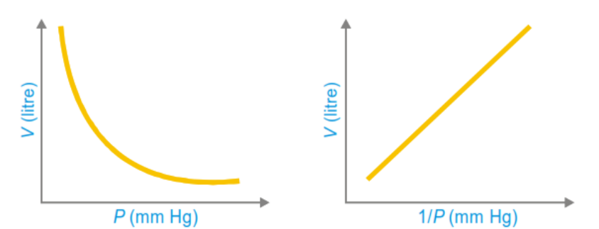{: .fig}

A plot of V against P is a rectangular hyperbola, while a plot of V against 1/P is a straight line passing through the origin. Boyle's law can be demonstrated with a simple J-tube experiment: as mercury is added to the closed end of the tube, the pressure on the trapped gas increases and its volume correspondingly decreases.

### 2.2 Charles's Law (1787)

Jacques Charles investigated how the volume of a fixed mass of gas varies with temperature at constant pressure. He established that the volume of a fixed mass of gas is directly proportional to its absolute (Kelvin) temperature when the pressure is held constant.

$$
V \propto T\quad (n,\,P \text{ constant}) \qquad \text{or} \qquad \frac{V}{T} = \text{constant } (k)
$$

For two temperature–volume states at constant pressure:

$$
\frac{V_1}{T_1} = \frac{V_2}{T_2}
$$

A graph of volume against Kelvin temperature is a straight line passing through the origin. Extrapolation of this line to zero volume gives a temperature of –273.15 °C, which is taken as the zero of the Kelvin (absolute) scale – the theoretical temperature at which an ideal gas would occupy zero volume.

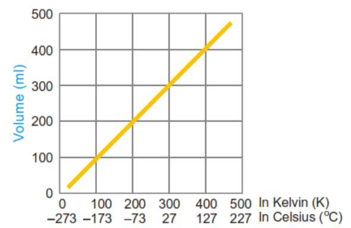{: .fig}

### 2.3 Gay-Lussac's Law (Pressure–Temperature Law, 1802)

Joseph Gay-Lussac showed that, at constant volume, the pressure of a fixed mass of gas is directly proportional to its absolute temperature.

$$
P \propto T\quad (n,\,V \text{ constant}) \qquad \text{or} \qquad \frac{P}{T} = \text{constant } (k)
$$

$$
\frac{P_1}{T_1} = \frac{P_2}{T_2}
$$

This law explains, for example, why the pressure inside a sealed container rises when the container is heated, and why tyre pressure increases on a hot day.

### 2.4 Avogadro's Law (1811)

Amedeo Avogadro proposed that equal volumes of different gases, measured at the same temperature and pressure, contain equal numbers of molecules, irrespective of the chemical nature of the gas.

$$
V \propto n\quad (T,\,P \text{ constant}) \qquad \text{or} \qquad \frac{V}{n} = \text{constant}
$$

A direct consequence of Avogadro's law is the concept of molar volume: one mole of any gas, behaving ideally, occupies the same volume at a given temperature and pressure. At standard temperature and pressure (STP: 273 K, 1 atm) this molar volume is 22.4 litres.

### 2.5 The Combined Gas Law

Boyle's law, Charles's law and Gay-Lussac's law can be merged into a single relationship, valid for a fixed mass (fixed number of moles) of gas, known as the combined gas law:

$$
\frac{PV}{T} = \text{constant} \qquad \text{i.e.} \qquad \frac{P_1V_1}{T_1} = \frac{P_2V_2}{T_2}
$$

This relation is extremely useful for solving problems in which pressure, volume and temperature all change simultaneously, since it removes the need to apply the three separate laws in sequence.

#### Worked Example 2.1
{: .example}

A sample of gas occupies 25.8 litres at a pressure of 690 torr and a temperature of 17 °C. Find its volume if the pressure is changed to 1.85 atm and the temperature to 345 K.

|**Quantity**|**Initial state**|**Final state**|
|---|---|---|
|Volume|V₁ = 25.8 L|V₂ = ?|
|Pressure|P₁ = 690 torr = 0.908 atm|P₂ = 1.85 atm|
|Temperature|T₁ = 17 °C = 290 K|T₂ = 345 K|

Applying the combined gas law, P₁V₁/T₁ = P₂V₂/T₂:

_V₂ = (P₁V₁T₂)/(T₁P₂) = (0.908 × 25.8 × 345)/(290 × 1.85) ≈ 15.1 litres_

### 2.6 The Ideal Gas Equation

Boyle's law (V ∝ 1/P), Charles's law (V ∝ T) and Avogadro's law (V ∝ n) can be combined into one general relationship describing the state of an ideal gas:

$$
V \propto \frac{nT}{P}
$$

Introducing a proportionality constant, R, called the universal gas constant, converts this proportionality into an equation:

$$
PV = nRT
$$

This is the ideal gas equation (also called the equation of state for an ideal gas), because it links all four state variables – P, V, n and T – in one expression. If any three of these quantities are known, the fourth can always be calculated. For one mole of gas (n = 1), the equation simplifies to PV = RT.

#### Numerical value of R

Since one mole of an ideal gas occupies 22.4 litres at STP (1 atm, 273 K):

_R = PV/nT = (1 atm × 22.4 L)/(1 mol × 273 K) = 0.0821 L atm K⁻¹ mol⁻¹_

|**Value of R**|**Units**|
|---|---|
|0.0821|litre-atm K⁻¹ mol⁻¹|
|82.1|mL-atm K⁻¹ mol⁻¹|
|62.3|litre-mm Hg K⁻¹ mol⁻¹|
|8.314|joule K⁻¹ mol⁻¹ (SI unit)|
|8.314 × 10⁷|erg K⁻¹ mol⁻¹|
|1.987 ≈ 2|cal K⁻¹ mol⁻¹|

Since R has the dimensions of (pressure × volume)/(amount × temperature), and pressure × volume has the dimensions of energy (force × length), R is properly regarded as a molar energy constant – the amount of work or energy associated with one mole of gas per unit of absolute temperature. This interpretation becomes important later when the kinetic theory is used to relate temperature to molecular kinetic energy.

## 3. Dalton's Law of Partial Pressures

When two or more gases that do not react chemically are placed together in the same container, each gas behaves independently, exerting a pressure as though it alone occupied the entire volume. The pressure contributed by each component gas is called its partial pressure.

John Dalton's Law of Partial Pressures (1807) states that the total pressure exerted by a mixture of nonreacting gases is equal to the sum of the partial pressures of all the individual gases present:

$$
P_{\text{total}} = P_1 + P_2 + P_3 + \dots
$$

This follows directly from the ideal gas equation applied separately to each component. If n₁, n₂, n₃ … are the number of moles of each gas sharing a common volume V at a common temperature T:

$$
P_1 = \frac{n_1RT}{V},\quad P_2 = \frac{n_2RT}{V},\quad P_3 = \frac{n_3RT}{V},\ \dots
$$

Summing these expressions gives P(total) = (n₁ + n₂ + n₃ + …)RT/V = n(total)RT/V, showing that the total pressure of a gas mixture depends only on the total number of moles present, regardless of the identity of the individual gases.

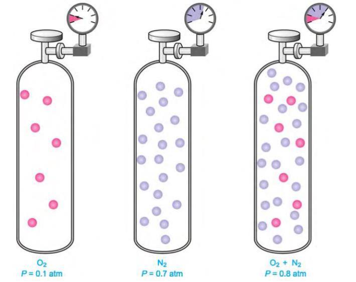{: .fig}

#### Mole fraction and partial pressure

The partial pressure of any one component may also be expressed in terms of its mole fraction (x) in the mixture:

$$
P_i = x_i \times P_{\text{total}}, \qquad \text{where } x_i = \frac{n_i}{n_{\text{total}}}
$$

#### Application: collection of gas over water

A common laboratory application of Dalton's law arises when a gas is collected by downward displacement of water. The gas collected is always “wet” – that is, it is mixed with water vapour. The total pressure measured (usually equal to the prevailing atmospheric/barometric pressure once water levels inside and outside the vessel are equalised) is the sum of the partial pressure of the dry gas and the vapour pressure of water at that temperature:

$$
P_{\text{atm}} = P_{\text{dry gas}} + P_{\mathrm{H_2O}}
$$

so that the partial pressure of the dry gas can be found simply by subtracting the known vapour pressure of water at the given temperature from the barometric pressure.

#### Worked Example 3.1
{: .example}

Calculate the pressure exerted by a mixture of 2.00 g of H₂ and 8.00 g of N₂ at 273 K in a 10-litre vessel. Moles of H₂ = 2.00/2.02 = 0.990 mol;  Moles of N₂ = 8.00/28 = 0.286 mol

$$
\begin{aligned} P_{\mathrm{H_2}} &= \frac{nRT}{V} = \frac{0.990 \times 0.0821 \times 273}{10} = 2.20 \text{ atm} \\ P_{\mathrm{N_2}} &= \frac{0.286 \times 0.0821 \times 273}{10} = 0.64 \text{ atm} \\ P_{\text{total}} &= 2.20 + 0.64 = 2.84 \text{ atm} \end{aligned}
$$

## 4. Graham's Laws of Diffusion and Effusion

### 4.1 Diffusion

When two gases are brought into contact, their molecules intermingle spontaneously through random molecular motion until a homogeneous mixture is formed. This process is called diffusion. Thomas Graham observed experimentally that lighter gas molecules diffuse faster than heavier ones.

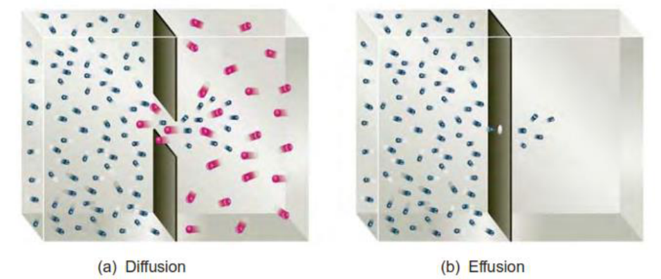{: .fig}

Graham's Law of Diffusion (1829) states that, under identical conditions of temperature and pressure, the rate of diffusion of a gas is inversely proportional to the square root of its molecular mass (or, equivalently, its vapour density):

$$
r \propto \frac{1}{\sqrt{M}} \qquad \text{so that} \qquad \frac{r_1}{r_2} = \sqrt{\frac{M_2}{M_1}}
$$

where r₁ and r₂ are the rates of diffusion of gases 1 and 2, and M₁ and M₂ their respective molar masses. Since vapour density (VD) is proportional to molar mass (M = 2 × VD for gases referred to hydrogen), the law is equally often written as r₁/r₂ = √(VD₂/VD₁).

### 4.2 Effusion

When a gas escapes from a container through a very small opening (a pinhole) into a region of lower pressure or vacuum, without the molecules undergoing collisions with one another as they pass through the opening, the process is called effusion, to distinguish it from diffusion, which involves molecular collisions throughout a bulk mixing process. Like diffusion, the rate of effusion of a gas depends inversely on the square root of its molar mass, and Graham's law of effusion is normally written in the same mathematical form as Graham's law:

_(Rate of effusion of gas 1)/(Rate of effusion of gas 2) = √(M₂/M₁)   (P, T constant)_

Because the rate of effusion of a gas is far easier to measure experimentally than its rate of diffusion (which is complicated by molecular collisions), effusion measurements are the practical basis on which Graham's law is used to determine unknown molecular masses, and were historically important in the separation of isotopes (e.g. enrichment of uranium-235 by gaseous effusion of UF₆).

#### Worked Example 4.1
{: .example}

A gas diffuses at half the rate of oxygen gas. Determine its molecular mass.

_r₁/r₂ = √(M₂/M₁)_ ⇒ _1/2 = √(32/M₁)_ ⇒ _1/4 = 32/M₁_ ⇒ _M₁ = 128_

#### Worked Example 4.2
{: .example}

50 mL of a gas A effuses through a pinhole in 146 seconds, while the same volume of CO₂ effuses in 115 seconds under identical conditions. Find the molar mass of A.

$$
\begin{aligned} \frac{\text{Rate of CO}_2}{\text{Rate of A}} &= \frac{50/115}{50/146} = 1.27 = \sqrt{\frac{M_A}{44}} \\ (1.27)^2 &= \frac{M_A}{44} \;\Rightarrow\; M_A \approx 71 \text{ g mol}^{-1} \end{aligned}
$$

## 5. Kinetic Molecular Theory of Gases

The gas laws described above are purely empirical – they summarise experimental observations but do not explain, in terms of the behaviour of individual molecules, why gases behave as they do. This explanation is provided by the Kinetic Molecular Theory (KMT), developed principally by Clausius, Maxwell and Boltzmann during the nineteenth century. The theory treats a gas as a very large collection of tiny particles in ceaseless, random motion, and derives the macroscopic gas laws from the mechanics of molecular collisions.

### 5.1 Postulates of the Kinetic Molecular Theory

1. A gas consists of a very large number of extremely small, discrete particles called molecules, dispersed throughout the container. The actual volume occupied by the molecules themselves is negligible compared with the total volume of the gas; all molecules of a given gas are identical and have the same mass.

2. The molecules are in continuous, random motion, travelling in straight lines with high velocities. They change direction abruptly only when they collide with one another or with the walls of the container.

3. The average distance between molecules is very large compared with molecular dimensions, so that intermolecular attractive (van der Waals) forces are assumed to be negligible; molecules therefore move independently of one another between collisions.

4. All collisions – between molecules, and between molecules and the container walls – are perfectly elastic; that is, there is no net loss of kinetic energy during a collision, although energy may be exchanged between colliding molecules.

5. The pressure exerted by a gas arises entirely from the sum of the impacts of its molecules on the walls of the container per unit area.

6. The average kinetic energy of the gas molecules is directly proportional to the absolute (Kelvin) temperature of the gas; at a given temperature, all gases – regardless of their chemical identity – have the same average molecular kinetic energy.

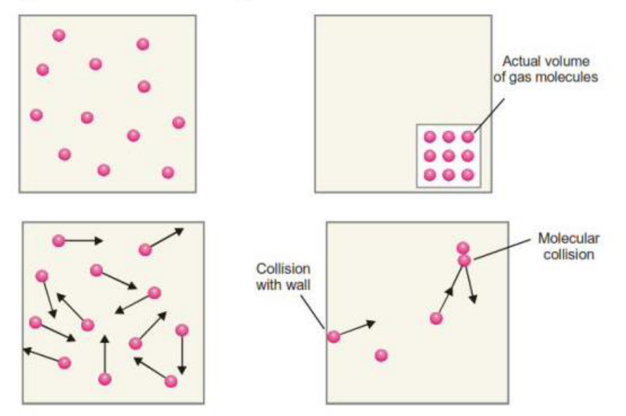{: .fig}

A gas that obeys all of these postulates exactly, under all conditions of temperature and pressure, is called an ideal (or perfect) gas. Real gases such as H₂, N₂, O₂ and CO₂ depart from postulates (1)–(3): their molecules occupy a finite (non-negligible) volume, and weak but real attractive forces exist between them. Consequently, real gases obey the ideal gas laws closely only at low pressure and moderately high temperature, where the molecules are far apart and their kinetic energy is large compared with the energy of intermolecular attraction; at low temperature and high pressure, where molecules are forced close together, marked deviations from ideal behaviour are observed (discussed in detail in Section 10).

### 5.2 Derivation of the Kinetic Gas Equation

The kinetic gas equation expresses the product PV of a gas in terms of the number, mass and velocity of its molecules, and is derived from the postulates of the kinetic theory using elementary mechanics. The derivation given below considers a gas enclosed in a cubical container.

Let a cubic box of edge length l contain N molecules of a gas, each of mass m. Consider a single molecule moving with velocity v; because velocity is a vector, it may be resolved into three mutually perpendicular components vₓ, vᵧ and vᵩ along the X, Y and Z axes, related to the resultant velocity by:

_v² = vₓ² + vᵧ² + vᵩ²_

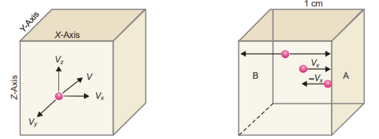{: .fig}

Consider the component vₓ, which governs the motion of the molecule between the two faces of the cube perpendicular to the X-axis. The molecule strikes one face with velocity vₓ and rebounds elastically with velocity –vₓ; the change of momentum per collision on that face is therefore:

_Δp = mvₓ – (–mvₓ) = 2mvₓ_

To return and strike the same face again, the molecule must travel a distance 2l (across to the opposite face and back). The time between successive collisions on the same face is therefore 2l/vₓ, so the number of collisions made on that face per second is vₓ/2l. The total rate of change of momentum (i.e. the force) that this one molecule exerts on that face is:

_Force = 2mvₓ × (vₓ/2l) = mvₓ²/l_

Since the molecule strikes all three pairs of opposite faces in an analogous manner, the total force it exerts on all faces of the box, summed over the X, Y and Z directions, is proportional to m(vₓ²+vᵧ²+vᵩ²)/l = mv²/l. Summing the contributions of all N molecules in the box (which, in general, move with different individual speeds v₁, v₂, …, vₙ) gives a total force proportional to mNu²/l, where u² is the mean of the squares of the individual molecular speeds (the mean square speed). Dividing this total force by the area of one face (l²) gives the pressure P exerted by the gas, and because the volume of the box is V = l³, careful bookkeeping of the three coordinate directions leads to the final result:

$$
PV = \tfrac{1}{3}\, m N u^2
$$

This is the Kinetic Gas Equation. Although it has been derived here for a cubical container, the result is general and applies to a vessel of any shape, since any volume can be imagined to be built up from a very large number of infinitesimally small cubes, for each of which the derivation holds. The quantity u = √u² is called the root-mean-square (RMS) speed of the gas molecules.

### 5.3 Kinetic Gas Equation in Terms of Kinetic Energy

The kinetic gas equation can be rewritten in terms of the average translational kinetic energy of the molecules. Since the average kinetic energy of a single molecule is e = ½mu², we have mu² = 2e, and:

_PV = ⅓ N (mu²) = ⅓ N (2e) = ⅔ N e = ⅔ E_

where E = Ne is the total kinetic energy of all N molecules in the sample. Comparing this with the ideal gas equation, PV = nRT, gives:

$$
\tfrac{2}{3}E = nRT \quad\Rightarrow\quad E = \tfrac{3}{2}\, nRT
$$

For one mole of gas (n = 1), the total translational kinetic energy is:

$$
E = \tfrac{3}{2}\, RT
$$

and the average kinetic energy of a single molecule is obtained by dividing by the Avogadro number, N₀:

$$
e = \frac{3}{2}\,\frac{RT}{N_0} = \tfrac{3}{2}\, k_B T
$$

where kᴮ = R/N₀ is the Boltzmann constant. This is one of the most important results of the kinetic theory: it shows that the average translational kinetic energy of a gas molecule depends only on the absolute temperature, and is completely independent of the nature (identity, mass, or size) of the gas. It is this result that supplies the molecular-level meaning of temperature – temperature is, in effect, a measure of the average kinetic energy of molecular motion.

#### Worked Example 5.1
{: .example}

Calculate the average kinetic energy of a hydrogen molecule at 0 °C. (R = 8.314 × 10⁷ erg K⁻¹ mol⁻¹, N₀ = 6.02 × 10²³)

_e = ⅔ RT/N₀ = (3 × 8.314×10⁷ × 273)/(2 × 6.02×10²³) = 5.66 × 10⁻¹⁴ erg_

#### Worked Example 5.2
{: .example}

Calculate the kinetic energy of two moles of N₂ at 27 °C. (R = 8.314 J K⁻¹ mol⁻¹)

_E = ⅔ nRT = ⅔ × 2 × 8.314 × 300 = 7482.6 J_

### 5.4 Deduction of the Gas Laws from Kinetic Theory

A major triumph of the kinetic molecular theory is that it allows every one of the empirical gas laws described in Section 2 to be derived mathematically from the kinetic gas equation, PV = ⅓mNu², together with the postulate that average molecular kinetic energy is proportional to absolute temperature.

#### (a) Boyle's Law

Since ½mNu² ∝ T, we can write ½mNu² = kT for some constant k, so that mNu² = ⅔kT. Substituting into the kinetic gas equation, PV = ⅓mNu² = ⅔ × (2/3)kT... more directly, PV = ⅔ × (½mNu²) = ⅔ × kT =

(2k/3)T. At constant temperature this right-hand side is a fixed number, so PV = constant – which is precisely Boyle's law.

#### (b) Charles's Law

From PV = (2k/3)T, we get V = (2k/3P)T. At constant pressure, (2k/3P) is itself a constant, k′, so that V = k′T, i.e. V ∝ T at constant pressure – which is Charles's law.

#### (c) Avogadro's Law

Applying the kinetic equation separately to equal volumes of two different gases 1 and 2 at the same pressure gives P₁V₁ = ⅓m₁N₁u₁² and P₂V₂ = ⅓m₂N₂u₂². If P₁ = P₂ and V₁ = V₂, then m₁N₁u₁² = m₂N₂u₂². At the same temperature the average kinetic energy per molecule is also equal for both gases, i.e. ½m₁u₁² = ½m₂u₂². Dividing the first relation by the second gives N₁ = N₂ – i.e. equal volumes of gases at the same temperature and pressure contain equal numbers of molecules, which is Avogadro's law.

#### (d) Graham's Law of Diffusion

Using the same starting equations as in (c) but this time equating kinetic energies of gases 1 and 2 with, by Avogadro's law, N₁ = N₂, one obtains m₁u₁² = m₂u₂², so that u₁/u₂ = √(m₂/m₁) = √(M₂/M₁). Since the rate of diffusion of a gas is proportional to the average molecular speed, r₁/r₂ = √(M₂/M₁), which is Graham's law of diffusion.

_These four derivations show that the kinetic molecular theory is not merely a qualitative picture of gas behaviour; it is a fully quantitative theory from which every empirical gas law can be obtained as a mathematical consequence._

## 6. Distribution of Molecular Velocities – Maxwell's Law

The derivation of the kinetic gas equation in Section 5 implicitly assumed that all molecules of a gas move with a single common velocity, u, the root-mean-square velocity. In reality this is not the case. Gas molecules are continually colliding with one another; in every collision, kinetic energy is exchanged between the two colliding molecules – one typically speeds up while the other slows down. As millions of such collisions occur every second, the velocity of any individual molecule changes constantly and unpredictably. However, because the number of molecules in even a small sample of gas is enormous (of order 10²³), a statistically stable distribution of velocities is established, in which a definite, reproducible fraction of the molecules possesses a velocity lying within any given range at any instant.

### 6.1 Maxwell's Law of Distribution of Velocities

In 1860, James Clerk Maxwell used the laws of probability to derive a mathematical expression for the fraction of molecules of a gas possessing velocities within a given narrow range. If dNᴄ is the number of molecules (out of a total N) having speeds between C and C + dC, at absolute temperature T, for a gas of molar mass M, then Maxwell's distribution law is:

_dNᴄ/N = 4π (M/2πRT)^(3/2) × C² × e^(–MC²/2RT) × dC_

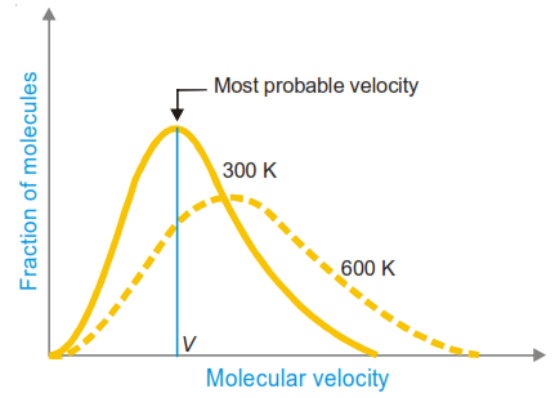{: .fig}

A plot of the fraction of molecules (dNᴄ/N, per unit speed interval) against speed C, for a fixed gas at a fixed temperature, is known as the Maxwell–Boltzmann speed-distribution curve. Several important features of this curve, illustrated schematically for nitrogen gas at 300 K and 600 K, are worth noting:

- Only a very small fraction of molecules possess either very low speeds (close to zero) or very high speeds; the great majority have speeds clustered around some intermediate value.

- The peak of the curve corresponds to the most probable speed – the speed possessed by the largest fraction of molecules.

- The curve is not symmetrical: it rises steeply on the low-speed side and falls off more gradually on the high-speed side, giving a long “tail” towards high speeds.

- As the temperature is raised, the whole curve broadens and its peak shifts towards higher speeds; a larger fraction of molecules acquires high speeds at high temperature, while the fraction with very low speeds decreases and the curve becomes flatter and more spread out.

- The area under the curve, representing the total number of molecules, remains constant (equal to N) regardless of temperature.

### 6.2 Different Kinds of Molecular Velocities

Three distinct “average” velocities are used to characterise the Maxwellian distribution of molecular speeds, and it is important to distinguish clearly between them.

#### (a) Average velocity (vₐᵥᵍ)

This is the simple arithmetic mean of the individual speeds of all N molecules:

$$
v_{\text{avg}} = \frac{v_1 + v_2 + v_3 + \dots + v_n}{N}
$$

Maxwell's distribution law shows that this quantity is given by:

$$
v_{\text{avg}} = \sqrt{\frac{8RT}{\pi M}}
$$

#### (b) Root mean square (RMS) velocity (u)

This is the square root of the mean of the squares of the individual molecular speeds:

$$
u = \sqrt{\frac{v_1^2 + v_2^2 + \dots + v_n^2}{N}} = \sqrt{\frac{3RT}{M}}
$$

The RMS velocity is the quantity that appears directly in the kinetic gas equation (PV = ⅓mNu²), and can therefore be obtained from purely macroscopic P, V, T data without needing to invoke Maxwell's distribution law explicitly.

#### (c) Most probable velocity (vₘₚ)

This is the speed possessed by the largest number (largest fraction) of molecules – that is, the speed corresponding to the peak (maximum) of the Maxwell distribution curve:

$$
v_{\text{mp}} = \sqrt{\frac{2RT}{M}}
$$

#### Relation among the three velocities

Because all three quantities are proportional to √(T/M), they can be expressed as simple numerical multiples of one another:

$$
v_{\text{avg}} = 0.9213 \times u \qquad \text{and} \qquad v_{\text{mp}} = 0.8165 \times u
$$

so that the three velocities are always in the ratio vₘₚ : vₐᵥᵍ : u = 0.8165 : 0.9213 : 1, or approximately 1 : 1.128 : 1.224. The root mean square velocity is always the largest of the three, followed by the average velocity, with the most probable velocity the smallest – a direct consequence of the asymmetric (positively skewed) shape of the Maxwell distribution curve.

|**Velocity type**|**Formula**|**Relative magnitude**|
|---|---|---|
|Most probable velocity, vₘₚ|√(2RT/M)|0.8165 u  (smallest)|
|Average velocity, vₐᵥᵍ|√(8RT/πM)|0.9213 u|
|Root mean square velocity, u|√(3RT/M)|u  (largest)|

### 6.3 Calculation of Molecular Velocities – Illustrative Cases

The RMS velocity of a gas can be calculated from the kinetic gas equation under various sets of given data:

- When only the temperature (and molar mass) are known: u = √(3RT/M), using R = 8.314×10⁷ erg K⁻¹ mol⁻¹ for u in cm s⁻¹.

- When temperature and pressure are both given but differ from STP: first convert the STP molar volume (22,400 mL) to the given conditions using the combined gas law, then apply u = √(3PV/M).

- At STP directly: u = √(3PV/M), with P = 76 × 13.6 × 981 dyne cm⁻² and V = 22,400 mL.

- When pressure and density are given (temperature not needed explicitly): u = √(3P/D), since M/V = D (density).

#### Worked Example 6.1
{: .example}

Calculate the root mean square velocity of a CO₂ molecule at 1000 °C. (M = 44 g mol⁻¹) T = 273 + 1000 = 1273 K. Using u = 1.58 × 10⁴ × √(T/M) cm s⁻¹ (a convenient form obtained by substituting R and converting units):

_u = 1.58 × 10⁴ × √(1273/44) ≈ 84,985 cm s⁻¹ = 849.85 m s⁻¹_

#### Worked Example 6.2
{: .example}

Calculate the average velocity of a nitrogen molecule at STP. (M = 28 g mol⁻¹)

_u = √(3PV/M) = √[3 × (76×13.6×981) × 22400 / 28] ≈ 49,330 cm s⁻¹ vₐᵥᵍ = 0.9213 × 49,330 ≈ 45,447 cm s⁻¹_

## 7. Molecular Collisions and the Mean Free Path

In deriving the simple kinetic gas equation, molecular collisions were not explicitly accounted for; molecules were assumed to travel between the walls of the container without interruption. In reality, however, gas molecules collide with one another extremely frequently, and it is precisely these collisions that are responsible for important transport properties of gases such as diffusion, viscosity, and thermal conductivity.

### 7.1 Free Path and Mean Free Path

Between two successive collisions, a gas molecule travels in a straight line; the distance it covers during this interval is called its free path. Because collisions are random events, the free path of a molecule varies unpredictably from one collision to the next. The mean free path, denoted λ, is defined as the average distance travelled by a molecule between successive collisions:

_λ = (l₁ + l₂ + l₃ + … + lₙ)/n_

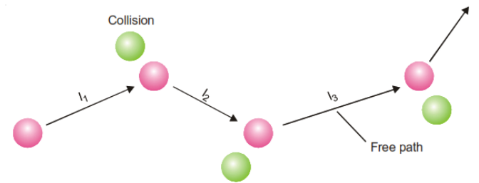{: .fig}

where l₁, l₂, … are the individual free paths and n is the number of collisions undergone. Clearly, the mean free path will be shorter when the gas is denser (molecules packed more closely, so more frequent collisions) and longer when the gas is more dilute. The mean free path is related to the coefficient of viscosity (η) of the gas by:

_λ = 3η / (P d)_

where P is the pressure and d is the density of the gas. At STP, the mean free path of hydrogen is about 1.78 × 10⁻⁵ cm, and that of oxygen about 1.0 × 10⁻⁵ cm – values that are far larger than molecular diameters (of order 10⁻⁸ cm), confirming that molecules spend most of their time travelling freely between infrequent collisions.

### 7.2 Effect of Temperature and Pressure on Mean Free Path

Using λ = 1/(√2 πσ²N), where σ is the collision diameter and N the number of molecules per unit volume, together with the ideal gas relation N ∝ P/T, it can be shown that:

- At constant pressure, the mean free path is directly proportional to the absolute temperature (λ ∝ T), because heating a gas at constant pressure causes it to expand, reducing the number of molecules per unit volume and hence the collision frequency.

- At constant temperature, the mean free path is inversely proportional to the pressure (λ ∝ 1/P), because increasing the pressure forces the molecules closer together, increasing N and hence the collision frequency.

### 7.3 Collision Diameter

When two gas molecules approach one another, they cannot come closer than a certain minimum distance before their (assumed spherical) electron clouds begin to repel strongly. This closest possible distance between the centres of two colliding molecules is called the collision diameter, denoted σ. Whenever the centre-to-centre distance between two molecules becomes equal to σ, a collision is considered to occur. The collision diameter can be determined experimentally from viscosity measurements; typical values are about 2.74 Å for hydrogen and 3.61 Å for oxygen. Smaller collision diameters correspond to a longer mean free path, since smaller molecules can travel further, on average, before colliding.

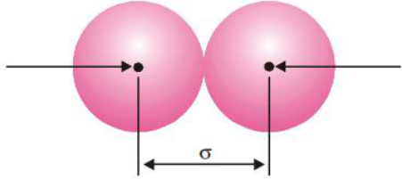{: .fig}

### 7.4 Collision Frequency

The collision frequency (Z) of a gas is defined as the total number of molecular collisions occurring per second in unit volume of the gas. If a gas contains N molecules per unit volume, average velocity v, and collision diameter σ, the number of collisions made by a single molecule per second is πσ²vN (approximately, ignoring a small correction factor for relative motion), and the total collision frequency, accounting for the fact that each collision involves two molecules, works out to:

$$
Z = \frac{\pi \sigma^2 \bar{v} N^2}{\sqrt{2}}
$$

From this expression, since v ∝ √T, the collision frequency increases with the square root of the absolute temperature (Z ∝ √T) at constant N; and since N ∝ P at constant temperature, the collision frequency increases with the square of the pressure (Z ∝ P²). Collision frequency also increases with molecular size (larger σ) and with the number density of molecules.

#### Worked Example 7.1
{: .example}

At 0 °C and 1 atm pressure the molecular diameter of a gas is 4 Å. Calculate the mean free path of its molecules. (22,400 mL of gas at STP contains 6.02 × 10²³ molecules.)

Number of molecules per cm³, N = 6.02×10²³/22400 = 2.689×10¹⁹ cm⁻³.

_λ = 1/(√2 πσ²N) = 1/[1.414 × 3.14 × (4×10⁻⁸)² × 2.689×10¹⁹] ≈ 0.524 × 10⁻⁵ cm_

## 8. Viscosity of Gases

Viscosity is the property of a fluid – liquid or gas – by virtue of which it resists relative motion between its adjacent layers. When a gas flows, the layer of gas in contact with a stationary surface (such as a pipe wall) is essentially motionless, while layers further away move progressively faster; there exists, therefore, a velocity gradient perpendicular to the direction of flow. Viscosity arises, at the molecular level, from the transport of momentum between adjacent layers moving at different speeds, brought about by molecules diffusing from a faster-moving layer into a slower one (and vice versa), each carrying its momentum with it.

Newton's law of viscous flow states that the force (F) required to maintain a velocity difference (dv) between two parallel layers of gas, separated by a distance dx and each of area A, is:

$$
F = \eta A \frac{dv}{dx}
$$

where η (eta) is the coefficient of viscosity, defined as the force per unit area required to maintain unit velocity gradient between two parallel layers of the fluid. In the CGS system, viscosity is expressed in poise (g cm⁻¹ s⁻¹); in SI units it is expressed in Pa s (= N s m⁻² = kg m⁻¹ s⁻¹).

### 8.1 Kinetic Theory of Gas Viscosity

According to the kinetic theory, gas viscosity results from the net transport of molecular momentum across the velocity gradient by molecules moving randomly between adjacent layers, each carrying, on average, the momentum characteristic of the layer it left. A simplified kinetic-theory treatment shows that the coefficient of viscosity of a gas is related to the average molecular velocity (v), the mean free path (λ), and the density (d) of the gas by an expression of the form:

$$
\eta = \tfrac{1}{3}\, d\, \bar{v}\, \lambda
$$

### 8.2 Unusual Features of Gas Viscosity

Unlike the viscosity of liquids, which decreases markedly as temperature rises (because thermal agitation more easily overcomes the intermolecular attractive forces responsible for liquid viscosity), the viscosity of a gas increases with increasing temperature. This is because gas viscosity arises from momentum transport by molecular motion; raising the temperature increases the average molecular velocity, which increases the rate of momentum transfer between layers, and hence increases viscosity.

A second notable feature, predicted by the simple kinetic theory (since η = ⅓dvλ, and λ ∝ 1/d, so that the density dependence cancels), is that the viscosity of a gas is essentially independent of pressure over a wide range of moderate pressures – a result confirmed experimentally, and one that sharply distinguishes gases from liquids, whose viscosities are essentially independent of pressure for a different reason (their nearincompressibility). At very low pressures (where the mean free path becomes comparable to the dimensions of the container) and at very high pressures (where real-gas effects become significant), this simple picture breaks down.

## 9. Equipartition of Energy and Molar Heat Capacities

### 9.1 Degrees of Freedom

The number of independent coordinates required to completely specify the position and configuration of a molecule in space is called its number of degrees of freedom. Molecular motion can be resolved into several independent modes, each of which is a separate degree of freedom:

- Translational degrees of freedom: motion of the molecule as a whole through space, resolved into three independent, mutually perpendicular directions (along the X, Y and Z axes). Every gas molecule, whatever its structure, therefore has three translational degrees of freedom.

- Rotational degrees of freedom: rotation of the molecule about axes passing through its centre of mass. A linear molecule (e.g. a diatomic molecule, or a linear triatomic molecule such as CO₂) has two rotational degrees of freedom, while a non-linear (bent or three-dimensional) molecule has three.

- Vibrational degrees of freedom: relative motion of the atoms within a molecule with respect to one another, along the lines joining them. Vibrational degrees of freedom increase rapidly with the number of atoms in the molecule, and each vibrational mode effectively contributes two “quadratic terms” to the energy (one kinetic, one potential).

### 9.2 The Law of Equipartition of Energy

The Principle (Law) of Equipartition of Energy, derived from classical statistical mechanics, states that the total energy of a molecule is distributed equally among all of its degrees of freedom, and that each degree of freedom (each independent quadratic term in the total energy expression) contributes, on average, an amount ½kᴮT of energy per molecule, or ½RT per mole.

For translational motion, resolved into three independent directions, the total average translational kinetic energy per molecule is therefore 3 × ½kᴮT = ¾kᴮT, in agreement with the result obtained directly from the kinetic gas equation in Section 5.3 (e = ¾kᴮT). This consistency between the equipartition principle and the kinetic-theory derivation is an important internal check on the theory.

### 9.3 Specific Heat at Constant Volume (Cv) and at Constant Pressure (Cp)

The molar heat capacity of a gas is the quantity of heat required to raise the temperature of one mole of the gas by one degree. Because gases can absorb heat either at constant volume or at constant pressure, two distinct molar heat capacities are defined.

#### Molar heat capacity at constant volume, Cv

When a gas is heated at constant volume, no external work is done (since the volume, and hence the boundary of the system, does not change); all of the heat supplied goes directly into increasing the internal (kinetic) energy of the molecules. For a monatomic gas, which possesses only translational degrees of freedom, the internal energy of one mole is E = ¾RT, so that a temperature rise of 1 K increases E by ¾R; hence:

_Cv = ¾R   (monatomic gas)_

For diatomic and polyatomic molecules, additional rotational (and, at sufficiently high temperature, vibrational) degrees of freedom contribute further to Cv; this extra contribution is generally denoted by a term x, so that in general:

_Cv = ¾R + x_

where x = 0 for monatomic gases, x = R for most diatomic gases (two rotational degrees of freedom, each contributing ½R), and x is larger still for non-linear polyatomic molecules (three rotational degrees of freedom, each contributing ½R, i.e. x = ¾R for many such gases at ordinary temperatures, before vibrational contributions become significant).

#### Molar heat capacity at constant pressure, Cp

When a gas is heated at constant pressure, it is free to expand, and part of the heat supplied is used to perform external work of expansion against the constant pressure, in addition to increasing the internal energy. For one mole of an ideal gas, the work done during an expansion ΔV produced by a 1 K rise in temperature at constant pressure P is PΔV = R (from the ideal gas equation). Hence Cp exceeds Cv by exactly R:

$$
C_p - C_v = R \qquad \text{(Mayer's relation)}
$$

so that for a monatomic gas Cp = ⁵⁄₂R, and in general Cp = ⁵⁄₂R + x.

### 9.4 The Specific Heat Ratio (γ) and Atomicity of Gases

The ratio γ = Cp/Cv, known as the specific heat ratio (or adiabatic index), is characteristic of the atomicity (the number of atoms per molecule) of a gas, and its experimental measurement is a classical method for determining whether a gas is monatomic, diatomic or polyatomic.

_γ = Cp/Cv = (⁵⁄₂R + x)/(¾R + x)_

|**Atomicity**|**x**|**Cv**|**Cp**|**γ = Cp/Cv**|**Examples**|
|---|---|---|---|---|---|
|Monatomic|0|¾R|⁵⁄₂R|1.67 (5/3)|He, Ar|
|Diatomic|R|⁵⁄₂R|⁷⁄₂R|1.40 (7/5)|N₂, O₂, H₂|
|Triatomic / polyatomic|¾R|3R|4R|1.33 (4/3)|CO₂, H₂S|

These theoretical ratios agree closely with experimentally measured values (e.g. γ ≈ 1.66 for helium and argon, 1.40 for nitrogen and oxygen, and 1.30–1.33 for carbon dioxide and hydrogen sulphide), providing strong supporting evidence for the equipartition principle and for the kinetic-molecular picture of gases generally.

## 10. Deviations of Real Gases from Ideal Behaviour

An ideal gas is defined as one that obeys the ideal gas equation, PV = nRT, exactly, at all temperatures and pressures. In practice, however, no real gas is truly ideal: all real gases – hydrogen, nitrogen, oxygen, carbon dioxide and so on – show measurable departures from ideal behaviour, particularly at high pressure and low temperature.

### 10.1 The Compressibility Factor

The extent to which a real gas deviates from ideality is conveniently expressed using the compressibility factor, Z, defined as:

Z = PV/nRT   (or, for one mole, Z = PV/RT)

For an ideal gas, Z = 1 under all conditions of temperature and pressure. For a real gas, Z generally differs from unity, and the magnitude of this difference is a direct measure of the degree of non-ideality: Z < 1 indicates that the gas is more compressible than an ideal gas (attractive forces dominate), while Z > 1 indicates that the gas is less compressible than an ideal gas (repulsive, finite-volume effects dominate).

### 10.2 Effect of Pressure on Deviations

A plot of Z against P at a fixed, moderate temperature reveals characteristic behaviour for different gases. For hydrogen, Z rises continuously above 1 as pressure increases from the outset, indicating that the finite volume of H₂ molecules dominates its behaviour even at moderate pressure. For nitrogen and carbon dioxide, however, Z first falls below 1 (attractive forces dominate at moderate pressure), passes through a minimum, and then rises above 1 at high pressure (as molecular volume effects take over). The dip below Z = 1 is deepest for gases such as CO₂ that are relatively easy to liquefy, reflecting their comparatively strong intermolecular attractions.

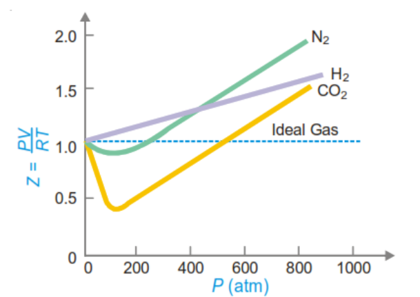{: .fig}

### 10.3 Effect of Temperature on Deviations – Boyle Temperature

As the temperature of a gas is raised, its deviations from ideal behaviour progressively diminish: the dip in the Z–P curve becomes shallower, and at a sufficiently high temperature it disappears altogether, the curve then remaining close to Z = 1 (i.e. Boyle's law is obeyed) over an appreciable range of pressures. The particular temperature at which this occurs – that is, the temperature at which a real gas behaves most nearly like an ideal gas over the widest possible pressure range – is called the Boyle temperature of that gas. The

Boyle temperature is a characteristic property of each gas; for nitrogen, for example, it is approximately 332 K.

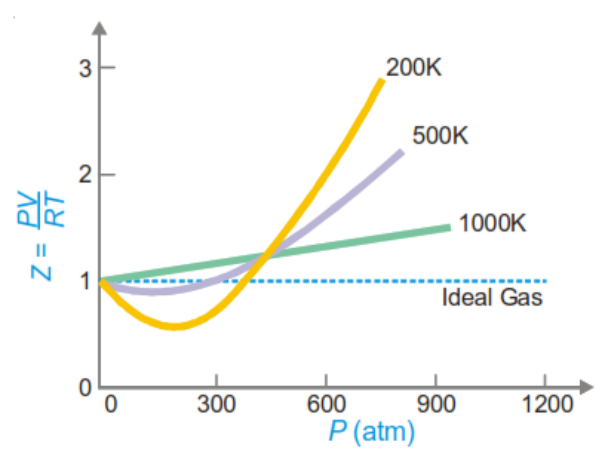{: .fig}

### 10.4 General Conclusions

- At low pressures and reasonably high temperatures, real gases behave nearly ideally, and the ideal gas equation gives a good approximation.

- At low temperatures and high pressures, real gases show significant departures from ideality, and the ideal gas equation fails.

- The closer a gas is to the conditions under which it would liquefy, the greater is its deviation from ideal behaviour.

## 11. The van der Waals Equation

In 1873, the Dutch physicist Johannes Diderik van der Waals proposed a modified form of the ideal gas equation that accounts for the observed deviations of real gases from ideality. He identified two assumptions of the kinetic theory that are not strictly valid for real gases, and introduced corresponding correction terms into the ideal gas equation.

### 11.1 The Two Faulty Assumptions

1. The kinetic theory assumes that gas molecules are point masses occupying no volume of their own; in reality, molecules have a finite size, and the space actually available for their movement is therefore somewhat less than the total volume of the container.

2. The kinetic theory assumes that there are no attractive forces between molecules; in reality, weak intermolecular (van der Waals) attractive forces do exist, and these forces act to reduce the pressure that the gas would otherwise exert on the walls of its container.

### 11.2 Volume Correction

Because real gas molecules possess a finite volume, the space actually available for molecular motion is less than the measured (container) volume V. Van der Waals introduced a correction term b, called the excluded volume (or co-volume) per mole, so that for n moles of gas the effective (“ideal”) volume becomes (V – nb).

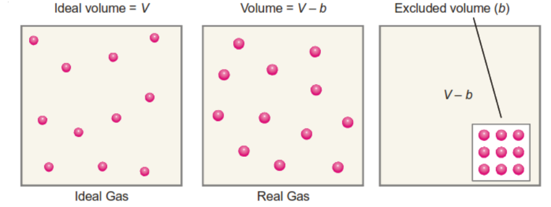{: .fig}

Importantly, the excluded volume b is not simply equal to the actual volume occupied by the molecules themselves; because two molecules cannot approach each other more closely than a distance equal to the sum of their radii (i.e. one molecular diameter, for identical molecules), the volume excluded from use by a pair of colliding molecules is that of a sphere of radius equal to the molecular diameter (twice the molecular radius, r). This excluded volume, divided equally between the two colliding molecules, works out to four times the actual volume of a single molecule:

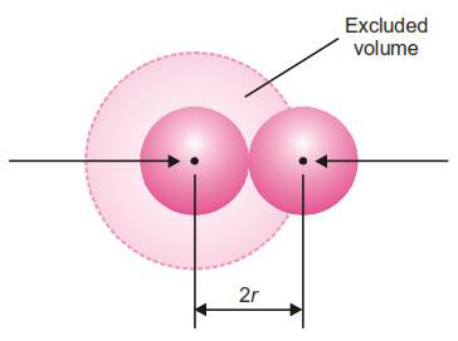{: .fig}

_Excluded volume per mole, b = 4 × N₀ × (⁴⁄₃πr³)_

### 11.3 Pressure Correction

A molecule in the bulk (interior) of a gas is attracted equally in all directions by the surrounding molecules, so that these attractive forces cancel out and have no net effect on its motion. However, a molecule that is just about to strike the container wall experiences an attractive pull from the other molecules on one side only (the side facing into the bulk of the gas), since there are no molecules beyond the wall to balance this pull.

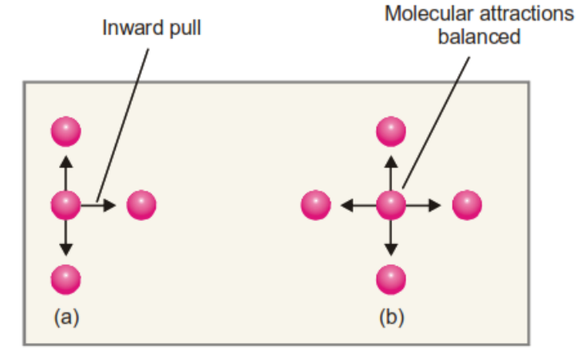{: .fig}

This net inward pull slightly reduces the velocity (and hence the momentum) with which the molecule strikes the wall, so that the pressure actually observed, P, is somewhat less than the pressure, P(ideal), that would be exerted in the absence of intermolecular attraction:

_P(ideal) = P + p,   where p is the pressure deficit due to intermolecular attraction_

The magnitude of this pressure correction, p, depends on the strength of the attractive forces, which in turn depends on the concentration of molecules near the wall (attracted) and the concentration of molecules in the bulk (attracting). Since both concentrations are proportional to n/V, the pressure correction is proportional to the square of the concentration:

_p = a n²/V²_

where a is a constant, characteristic of the gas, representing the strength of the intermolecular attractive forces. The pressure term in the ideal gas equation is therefore corrected by adding this term:

_P(ideal) = P + an²/V²_

### 11.4 Statement of the van der Waals Equation

Substituting the corrected pressure and corrected volume into the ideal gas equation PV = nRT gives the van der Waals equation, for n moles of a real gas:

$$
\left(P + \frac{an^2}{V^2}\right)(V - nb) = nRT
$$

For one mole of gas (n = 1), this simplifies to:

$$
\left(P + \frac{a}{V^2}\right)(V - b) = RT
$$

The quantities a and b are called the van der Waals constants; they are characteristic of each individual gas and are usually determined empirically by fitting the equation to experimental P–V–T data. The constant a (units: atm L² mol⁻², or N m⁴ mol⁻² in SI) reflects the strength of intermolecular attraction – larger values of a correspond to gases that are more easily liquefied. The constant b (units: L mol⁻¹, or m³ mol⁻¹ in SI) reflects the effective molecular size.

**_Table 11.1 – van der Waals constants of some common gases_**

|**Gas**|**a (atm L² mol⁻²)**|**b (L mol⁻¹)**|
|---|---|---|
|Hydrogen|0.245|0.0266|
|Oxygen|1.360|0.0318|
|Nitrogen|1.390|0.0391|
|Chlorine|6.493|0.0562|
|Carbon dioxide|3.590|0.0428|
|Ammonia|4.170|0.0371|
|Sulphur dioxide|6.710|0.0564|

#### Worked Example 11.1
{: .example}

Calculate the pressure exerted by 1.00 mole of methane in a 250 mL container at 300 K using the van der Waals equation, and compare with the value predicted by the ideal gas equation. (a = 2.253 L² atm mol⁻², b = 0.0428 L mol⁻¹, R = 0.0821 L atm K⁻¹ mol⁻¹.)

_P = nRT/(V–nb) – n²a/V² = (1×0.0821×300)/(0.250–0.0428) – (1×2.253)/(0.250)² ≈ 82.8 atm_ Ideal gas equation: P = nRT/V = (1 × 0.0821 × 300)/0.250 = 98.5 atm.

The van der Waals pressure is significantly lower than the ideal-gas prediction, reflecting the combined effect of the attraction correction (which lowers the predicted pressure) and the finite molecular volume (which, by shrinking the available volume, would tend to raise it) – in this case the attraction term dominates.

### 11.5 Interpreting Deviations Using the van der Waals Equation

Expanding the van der Waals equation for one mole, PV + a/V – Pb – ab/V² = RT, allows the compressibility behaviour discussed in Section 10 to be explained quantitatively:

- At low pressure (large V): the terms Pb and ab/V² become negligible compared with a/V, and the equation reduces approximately to PV ≈ RT – a/V, so that Z = PV/RT ≈ 1 – a/VRT, which is less than 1 – explaining why real gases show Z < 1 at moderate pressures.

- At high pressure (small V): the terms a/V and ab/V² become negligible compared with Pb, and the equation reduces approximately to PV ≈ RT + Pb, so that Z = PV/RT ≈ 1 + Pb/RT, which is greater than 1 – explaining why real gases show Z > 1 at high pressures.

- At very low pressure or very high temperature: all correction terms become negligible compared with RT, and the equation reduces to PV = RT – that is, real gases approach ideal behaviour under these conditions, exactly as observed experimentally.

- Exceptional behaviour of hydrogen and helium: because these molecules are very light and their intermolecular attractive forces (and hence the constant a) are extremely small, the a/V and ab/V² terms are negligible even at moderate pressures, so that Z = 1 + Pb/RT is greater than 1 at essentially all pressures – explaining why the Z–P curve for hydrogen lies above the ideal-gas line throughout, without the initial dip seen for gases such as N₂ and CO₂.

### 11.6 Limitations of the van der Waals Equation

The van der Waals equation gives a good qualitative and reasonably good quantitative account of real-gas behaviour over a wide range of pressures and temperatures, and correctly predicts the existence of a critical point (see Section 12). However, it does not agree exactly with experimental P–V–T data, particularly at very high pressures and low temperatures, where the assumption of a single, pressure-independent excluded volume b becomes increasingly inaccurate. Various more elaborate equations of state – for example the Dieterici equation, P(V–b) = RT e^(–a/VRT) – have since been proposed to improve on the van der Waals equation, though the latter remains the most widely used and pedagogically important equation of state for real gases because of its simple physical basis.

## 12. Liquefaction of Gases and the Critical Phenomenon

A gas can, in general, be converted into a liquid either by lowering its temperature (which reduces the average kinetic energy of the molecules, allowing intermolecular attractive forces to hold them together) or by increasing the pressure applied to it (which forces the molecules closer together). Thomas Andrews carried out a classic series of experiments (1869) in which he studied the pressure–volume behaviour of carbon dioxide at a range of fixed temperatures, and thereby established the existence of a critical temperature for every gas.

### 12.1 Critical Constants

The critical temperature (Tc) of a gas is defined as the temperature above which the gas cannot be liquefied, no matter how great a pressure is applied to it. The critical pressure (Pc) is the minimum pressure required to liquefy the gas when it is exactly at its critical temperature. The critical volume (Vc) is the volume occupied by one mole of the gas under conditions of critical temperature and critical pressure. Collectively, Tc, Pc and Vc are called the critical constants of a gas, and every real gas has its own characteristic set of critical constants.

**_Table 12.1 – Critical constants of some common gases_**

|**Gas**|**Tc (K)**|**Pc (atm)**|**Vc (mL mol⁻¹)**|
|---|---|---|---|
|Helium|5.3|2.26|57.8|
|Hydrogen|33.2|12.8|65.0|
|Nitrogen|126.0|33.5|90.1|
|Oxygen|154.3|50.1|74.4|
|Carbon dioxide|304.0|72.9|94.0|
|Ammonia|405.5|111.5|72.1|
|Chlorine|417.1|76.1|123.8|
|Sulphur dioxide|430.3|77.7|122.3|

### 12.2 Andrews' Isotherms of Carbon Dioxide

A plot of pressure against volume for a gas at a fixed temperature is called an isotherm. Andrews plotted a family of isotherms for carbon dioxide over a range of temperatures, and found that they fall into three characteristic types.

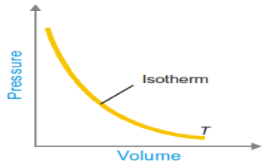{: .fig}

#### (a) Isotherms well above the critical temperature (e.g. 50 °C)

These isotherms closely resemble rectangular hyperbolas, approximating the P–V behaviour of an ideal gas; carbon dioxide remains entirely gaseous throughout the pressure range, and no liquid forms however high the pressure is raised.

#### (b) Isotherms below the critical temperature (e.g. 21 °C)

These isotherms show three distinct regions:

1. A curved portion in which the gas is compressed, its volume decreasing smoothly as pressure rises, obeying an approximately Boyle's-law-like relationship.

2. A horizontal (constant-pressure) portion, along which liquid CO₂ first appears and progressively increases in amount at the expense of the gas, the pressure remaining constant throughout while the volume continues to decrease as more gas condenses; at the end of this stage the sample is entirely liquid.

3. A steeply rising, almost vertical portion, corresponding to the compression of the liquid CO₂ itself, which – being far less compressible than the gas – shows only a very small decrease in volume for a large increase in pressure.

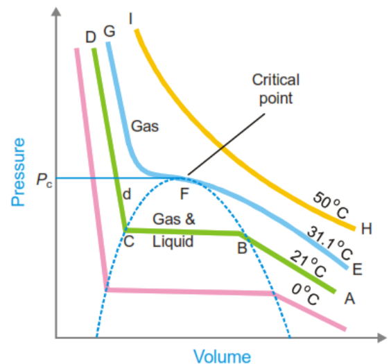{: .fig}

#### (c) The critical isotherm (31.1 °C for CO₂)

At exactly the critical temperature, the horizontal (two-phase) portion of the isotherm shrinks to a single point of inflection, called the critical point. At the critical point, the gas and liquid phases become identical – they have the same density and are no longer distinguishable from one another – and the meniscus that normally separates liquid from vapour disappears. Above the critical isotherm, no amount of applied pressure will bring about liquefaction; this is the origin of the definition of critical temperature given in Section 12.1.

### 12.3 Continuity of States – The van der Waals Interpretation

William Thomson (Lord Kelvin) pointed out that the sharp corners seen in Andrews' experimental isotherms are, in a sense, artefacts of the impossibility of maintaining certain unstable intermediate states in the laboratory, and that a truly continuous curve – predicted theoretically by the van der Waals equation –

actually connects the gas and liquid branches through a characteristic S-shaped (wavy) loop. Because the van der Waals equation is a cubic equation in V for any given P and T, it can in principle yield up to three distinct real roots (volumes) for the same pressure and temperature; these three roots converge to a single value exactly at the critical point, where the isotherm develops a horizontal point of inflection.

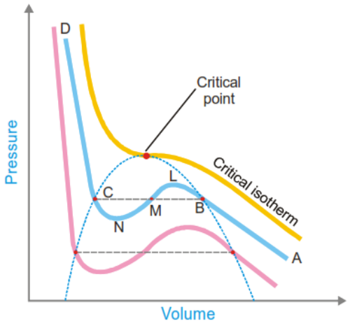{: .fig}

Applying the mathematical conditions for a point of inflection (that both the first and second derivatives of P with respect to V vanish at the critical point) to the van der Waals equation allows the critical constants to be expressed directly in terms of the van der Waals constants a and b:

$$
V_c = 3b \qquad P_c = \frac{a}{27b^2} \qquad T_c = \frac{8a}{27Rb}
$$

These relationships are extremely useful, since they allow the van der Waals constants of a gas to be calculated from experimentally measured critical constants, or vice versa. Combining the three expressions also gives the useful relation:

$$
a = 3P_cV_c^2 \qquad b = \frac{V_c}{3} \qquad R = \frac{8P_cV_c}{3T_c}
$$

#### Worked Example 12.1
{: .example}

The van der Waals constants for hydrogen chloride gas are a = 3.67 atm L² mol⁻² and b = 40.8 mL mol⁻¹. Find the critical temperature and critical pressure of the gas.

$$
T_c = \frac{8a}{27Rb} = \frac{8 \times 3.67}{27 \times 0.0821 \times 0.0408} \approx 324.7 \text{ K } (\approx 51.7\ ^\circ\text{C})
$$

$$
P_c = \frac{a}{27b^2} = \frac{3.67}{27 \times (0.0408)^2} \approx 81.6 \text{ atm}
$$

#### Worked Example 12.2
{: .example}

The critical constants for water are Tc = 647 K, Pc = 218 atm, Vc = 0.057 L mol⁻¹. Calculate the van der Waals constants a and b.

$$
\begin{aligned} a &= 3P_cV_c^2 = 3 \times 218 \times (0.057)^2 \approx 2.12 \text{ L}^2 \text{ atm mol}^{-2} \\ b &= \frac{V_c}{3} = \frac{0.057}{3} = 0.019 \text{ L mol}^{-1} \end{aligned}
$$

### 12.4 Experimental Determination of Critical Constants

The critical temperature and critical pressure of a substance can be measured relatively easily using an apparatus such as the Cagniard de la Tour apparatus – a sealed, mercury-filled glass tube containing the

liquid under study in a bulb at one end, with the open end acting as a manometer. As the bulb is gradually heated, the meniscus between liquid and vapour becomes progressively fainter and eventually disappears altogether, marking the critical temperature; the manometer reading at this point gives the critical pressure.

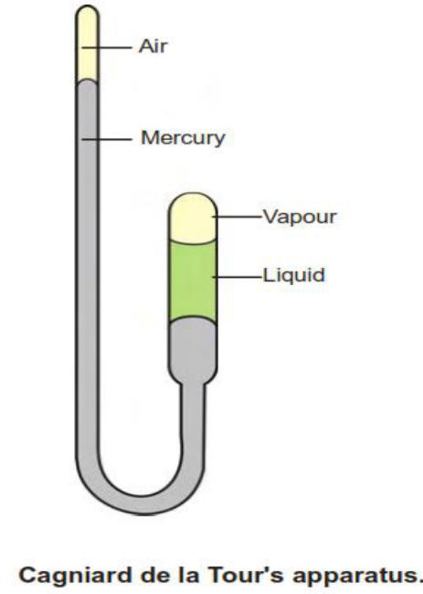{: .fig}

The critical volume is more difficult to measure directly, since even a small change in temperature or pressure near the critical point produces a disproportionately large change in volume. The most reliable method, due to Amagat, involves measuring the densities of the coexisting liquid and vapour phases at a series of temperatures approaching the critical point, plotting these densities against temperature, and extrapolating both curves until they converge – the point of convergence gives the critical density, from which the critical volume is obtained by dividing the molar mass by the critical density.

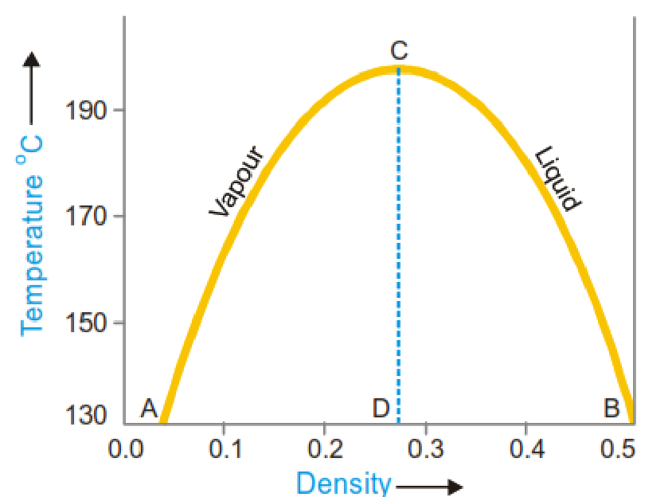{: .fig}

## 13. The Law of Corresponding States

Because the critical constants Tc, Pc and Vc are characteristic of each individual gas, it is useful to express the actual pressure, volume and temperature of any gas as fractions (ratios) of its own critical values. These dimensionless ratios are called the reduced pressure (π), reduced volume (ϕ) and reduced temperature (θ):

$$
\pi = \frac{P}{P_c}, \qquad \phi = \frac{V}{V_c}, \qquad \theta = \frac{T}{T_c}
$$

Substituting P = πPc, V = ϕVc and T = θTc into the van der Waals equation, and then replacing Pc, Vc and Tc by their expressions in terms of a, b and R (Section 12.3), leads – after algebraic simplification – to an equation in which the gas-specific constants a, b and R cancel out entirely:

$$
\left(\pi + \frac{3}{\phi^2}\right)(3\phi - 1) = 8\theta
$$

This is known as the van der Waals reduced equation of state. Because it contains no constants specific to any particular gas, it applies, in principle, to every gas (or, more precisely, to every substance that obeys the van der Waals equation) in exactly the same mathematical form.

This result constitutes the Law of Corresponding States: when two or more different gases have the same reduced temperature and the same reduced pressure, they will also have the same reduced volume. Two or more substances that share the same values of π and θ (and therefore, necessarily, the same value of ϕ) are said to be in corresponding states.

### 13.1 Significance and Applications

The law of corresponding states is a remarkable example of a “corresponding-states” or “correlative” principle in physical chemistry: it predicts that, when properties are expressed in suitably reduced (dimensionless) form, quite different substances should show near-identical behaviour, despite having very different absolute values of Tc, Pc and Vc individually. In practice this means, for instance, that the physical properties of different liquids are best compared at the same reduced temperature, rather than at the same absolute temperature, since pressure has only a minor effect on most liquid properties. Because the normal boiling point of many liquids is found empirically to be roughly two-thirds of the critical temperature (in kelvin), liquids at their boiling points are, to a good first approximation, already in corresponding states with one another – which is why comparisons of physical properties (surface tension, viscosity, etc.) across different liquids are conventionally made at their respective boiling points.

#### Worked Example 13.1
{: .example}

The reduced volume (ϕ) and reduced temperature (θ) of a gas are 10.2 and 0.7 respectively. Find its pressure if its critical pressure (Pc) is 4.25 atm.

_(π + 3/ϕ²)(3ϕ – 1) = 8θ_

_(π + 3/104.04)(30.6 – 1) = 5.6_ ⇒ _(π + 0.0288)(29.6) = 5.6_ ⇒ _π ≈ 0.1604_

_P = π × Pc = 0.1604 × 4.25 ≈ 0.682 atm_

## 14. Methods of Liquefaction of Gases

The Andrews isotherms (Section 12) show that, in principle, any gas can be liquefied provided it is first cooled below its critical temperature and then subjected to a sufficiently high pressure. In practice, three broad experimental strategies have historically been used to achieve the very low temperatures required, particularly for gases with very low critical temperatures such as hydrogen, nitrogen, oxygen and helium.

### 14.1 Faraday's Method – External Cooling

Michael Faraday (1823) liquefied a number of gases – including sulphur dioxide, carbon dioxide, nitric oxide and chlorine – by combining moderate compression with external cooling, using freezing mixtures such as ice mixed with various salts. Both the melting of ice and the dissolution of salt in water are endothermic processes, so that a salt/ice mixture can reach temperatures well below 0 °C, cooling the gas sufficiently to bring it below its critical temperature under the applied pressure. Faraday used a V-shaped sealed tube, generating the gas in one arm (which was externally cooled) while the gas liquefied under its own generated pressure. This method was successful only for gases with a critical temperature at or above ordinary room temperature; gases such as hydrogen, nitrogen and oxygen, which have very low critical temperatures, could not be liquefied in this way and were, for many years, referred to as “permanent gases.”

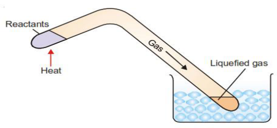{: .fig}

### 14.2 Linde's Method – the Joule–Thomson Effect

Carl von Linde (1895) exploited the Joule–Thomson effect: when a real, compressed gas is allowed to expand rapidly through a narrow throttling valve or jet into a region of much lower pressure, without doing external mechanical work, its temperature falls. This cooling occurs because energy must be expended, from the gas's own internal energy, to overcome the intermolecular attractive forces as the molecules move further apart during expansion; the reduction in kinetic energy (and hence temperature) that results is known as the Joule–Thomson effect.

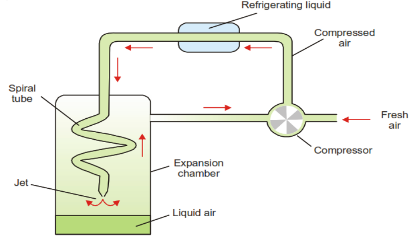{: .fig}

In Linde's apparatus for the liquefaction of air, air is first compressed to about 200 atmospheres and passed through a coil cooled externally (e.g. by circulating ammonia refrigerant) to remove the heat generated by compression. The cooled, compressed air then expands rapidly through a fine jet, cooling further by the Joule–Thomson effect. This cooled air is directed up through an expansion chamber, where it pre-cools the next batch of incoming compressed air flowing down through a spiral coil, before being recirculated to the compressor. By repeating this cycle of compression, cooling and expansion many times over, a temperature low enough to liquefy air is progressively reached, and liquid air collects at the base of the expansion chamber.

### 14.3 Claude's Method – Expansion with External Work

Georges Claude's method is a refinement of Linde's process that achieves greater cooling efficiency. In addition to the Joule–Thomson expansion used in Linde's method, part of the compressed gas in Claude's apparatus is diverted into the cylinder of a small engine, where it is made to perform mechanical work by pushing back a piston. Because this expanding gas does external work at the expense of its own internal energy (rather than merely overcoming intermolecular attraction), it cools considerably more than gas undergoing simple Joule–Thomson expansion alone. The pre-cooled gas from the engine, together with gas that has undergone jet expansion, together cool the incoming compressed air in the expansion chamber; repeated cycling ultimately liquefies the air, with any gas that escapes liquefaction being returned to the compressor for another pass. Because cooling is produced both by overcoming intermolecular attraction and by the performance of mechanical work, Claude's method is more efficient than Linde's method and requires less extreme initial compression.

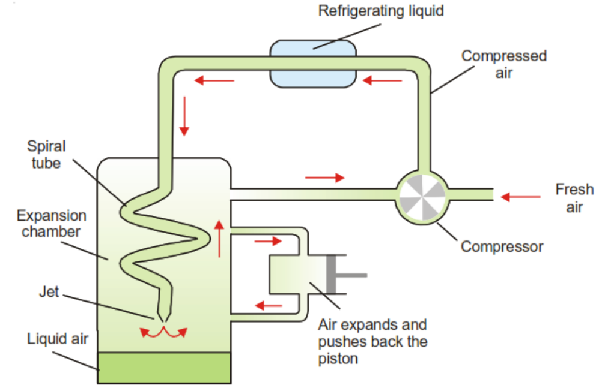{: .fig}

#### Table 14.1 – Comparison of liquefaction methods

|**Method**|**Principle of cooling**|**Typical gases liquefied**|
|---|---|---|
|Faraday's method|External cooling with a freezing mixture, combined with moderate pressure|SO₂, CO₂, NO, Cl₂ (gases with Tc near room temperature)|
|Linde's method|Joule–Thomson effect – cooling on free expansion through a jet|Air, N₂, O₂|
|Claude's method|Joule–Thomson expansion plus expansion against a piston (external mechanical work)|Air and other permanent gases, more efficiently than Linde's method|

## 15. Summary of Key Equations

|**Law / Concept**|**Equation**|
|---|---|
|Boyle's Law|PV = constant (at constant T, n)|
|Charles's Law|V/T = constant (at constant P, n)|
|Gay-Lussac's Law|P/T = constant (at constant V, n)|
|Avogadro's Law|V/n = constant (at constant T, P)|
|Combined Gas Law|P₁V₁/T₁ = P₂V₂/T₂|
|Ideal Gas Equation|PV = nRT|
|Dalton's Law|P(total) = P₁ + P₂ + …|
|Graham's Law|r₁/r₂ = √(M₂/M₁)|
|Kinetic Gas Equation|PV = ⅓ m N u²|
|Average KE per molecule|e = ¾ kᴮT|
|RMS velocity|u = √(3RT/M)|
|Average velocity|vₐᵥᵍ = √(8RT/πM)|
|Most probable velocity|vₘₚ = √(2RT/M)|
|Mean free path|λ = 3η/(Pd)|
|Mayer's relation|Cp – Cv = R|
|Compressibility factor|Z = PV/nRT|
|van der Waals equation|(P + an²/V²)(V–nb) = nRT|
|Critical constants (vdW)|Vc=3b, Pc=a/27b², Tc=8a/27Rb|
|Reduced equation of state|(π + 3/ϕ²)(3ϕ–1) = 8θ|

## 16. Review and Practice Questions

### 16.1 Short Answer / Definitions

1. Define or explain: (a) Boyle's law (b) Charles's law (c) absolute zero (d) Avogadro's law (e) the combined gas law (f) the ideal gas equation (g) the gas constant R (h) Dalton's law (i) Graham's law (j) mean free path (k) collision frequency (l) specific heat at constant volume and at constant pressure (m) molar heat capacity (n) real gases (o) the van der Waals equation (p) critical temperature (q) critical pressure (r) critical volume.

2. State the postulates of the kinetic molecular theory of gases and comment on how far each is justified for real gases.

3. Derive the kinetic gas equation for an ideal gas, stating clearly the assumptions used.

4. Show that the total kinetic energy of one mole of an ideal gas is ¾RT.

5. Deduce Boyle's law, Charles's law, Avogadro's law and Graham's law of diffusion from the kinetic gas equation.

6. Explain what is meant by the distribution of molecular velocities in a gas, illustrating your answer with a labelled diagram of the Maxwell distribution curve at two different temperatures.

7. Distinguish clearly between the average velocity, the root mean square velocity and the most probable velocity of gas molecules, giving the formula for each and their relative magnitudes.

8. Define mean free path and collision diameter, and explain how each is affected by changes in temperature and pressure.

9. What is meant by the equipartition of energy? Use this principle to explain why Cv for a diatomic gas is greater than Cv for a monatomic gas.

**10.** Explain the meaning of the compressibility factor, Z, and describe how it varies with pressure for hydrogen and for carbon dioxide.

**11.** State the faulty assumptions of the kinetic theory that led van der Waals to modify the ideal gas equation, and derive the van der Waals equation for n moles of a real gas.

**12.** Explain, using the van der Waals equation, why real gases show Z < 1 at low pressure and Z > 1 at high pressure.

**13.** Define the critical temperature, critical pressure and critical volume of a gas, and describe briefly how each may be determined experimentally.

**14.** Derive expressions for the critical constants Vc, Pc and Tc in terms of the van der Waals constants a, b and R.

**15.** State and explain the law of corresponding states. What is its significance in the study of liquids?

**16.** Describe, with the help of a labelled diagram, Faraday's method, Linde's method and Claude's method for the liquefaction of gases, and explain why Claude's method is more efficient than Linde's method.

### 16.2 Numerical Problems

**17.** 25.8 litres of a gas has a pressure of 690 torr and a temperature of 17 °C. Calculate its volume if the pressure is changed to 1.85 atm and the temperature to 345 K.  [Ans: 15.1 L]

**18.** Calculate the pressure exerted by a mixture of 2.00 g of H₂ and 8.00 g of N₂ at 273 K in a 10-litre vessel.  [Ans: 2.84 atm]

**19.** If a gas diffuses at a rate one-half that of oxygen, find its molecular mass.  [Ans: 128]

**20.** 50 mL of gas A effuses through a pinhole in 146 s; the same volume of CO₂ effuses in 115 s under identical conditions. Calculate the molar mass of A.  [Ans: 71]

**21.** Calculate the average kinetic energy of a hydrogen molecule at 0 °C.  [Ans: 5.66 × 10⁻¹⁴ erg]

**22.** Calculate the kinetic energy of two moles of N₂ at 27 °C.  [Ans: 7482.6 J]

**23.** Calculate the root mean square velocity of a CO₂ molecule at 1000 °C.  [Ans: ≈ 849.9 m s⁻¹]

**24.** Calculate the average velocity of a nitrogen molecule at STP.  [Ans: ≈ 45,447 cm s⁻¹]

**25.** At 0 °C and 1 atm, the molecular diameter of a gas is 4 Å. Calculate its mean free path.  [Ans: ≈ 0.524 × 10⁻⁵ cm]

**26.** One mole of water vapour is confined to a 20-litre flask at 27 °C. Calculate its pressure using (a) the van der Waals equation and (b) the ideal gas equation. (a = 5.464 L² atm mol⁻², b = 0.0305 L mol⁻¹) [Ans: (a) 1.218 atm (b) 1.232 atm]

**27.** van der Waals constants for HCl gas are a = 3.67 atm L² mol⁻² and b = 40.8 mL mol⁻¹. Find Tc and Pc. [Ans: Tc = 324.7 K, Pc = 81.6 atm]

**28.** The critical constants of water are Tc = 647 K, Pc = 218 atm, Vc = 0.057 L mol⁻¹. Calculate the van der Waals constants a and b.  [Ans: a = 2.12 L² atm mol⁻², b = 0.019 L mol⁻¹]

**29.** The reduced volume and reduced temperature of a gas are 10.2 and 0.7 respectively; its critical pressure is 4.25 atm. Find its actual pressure.  [Ans: ≈ 0.68 atm]

**30.** Calculate the root mean square velocity of oxygen molecules at 27 °C.  [Ans: 4.835 × 10⁴ cm s⁻¹]

**31.** A 10-litre flask contains 64 g of oxygen at 27 °C. Calculate its pressure using (a) the van der Waals equation and (b) the ideal gas equation. (a = 4.17 atm L² mol⁻², b = 0.037 L mol⁻¹)  [Ans: (a) 4.808 atm (b) 4.938 atm]

---

[← Course home](./) · [Back to top](#)

