
[← Course home](./) · [Download the PDF](assets/pdf/unit2.pdf)
{: .crumbs}

# Unit 2: Laws of Thermodynamics and Thermochemistry

**Syllabus coverage:** *Work and heat. First law of thermodynamics. Enthalpy, heat capacities. Gas expansion – isothermal, adiabatic. Thermochemistry–standard enthalpy of formation, dependence of enthalpy of reaction on temperature. Bond energies and bond dissociation enthalpies. Spontaneous process. Entropy – statistical and thermodynamic definition. The Carnot heat engine – thermodynamic efficiency. Second law of thermodynamics – entropy change - mixing of ideal gases - phase transition – heating. The third law of thermodynamics – residual entropy.*

Contents

* TOC
{:toc}

## Learning Objectives

On completing this unit, the student should be able to:

- Classify thermodynamic systems and distinguish state functions from path functions.

- State and apply the First Law of Thermodynamics to isothermal, adiabatic, isobaric and isochoric processes.

- Derive and use expressions for enthalpy, heat capacities and their inter-relationship.

- Calculate the work done in reversible and irreversible expansion/compression of ideal gases.

- Apply Hess's Law and Kirchhoff's equation to thermochemical calculations.

- Estimate reaction enthalpies from bond energies.

- Explain spontaneity, entropy and the statistical basis of the Second Law.

- Analyse the Carnot cycle and calculate the efficiency of heat engines.

- State the Third Law of Thermodynamics and explain residual entropy.

## List of Symbols and Notation

|**Symbol**|**Meaning**|**SI Unit**|
|---|---|---|
|E(or U)|Internal energy|J|
|H|Enthalpy|J|
|S|Entropy|J K⁻¹|
|q|Heat|J|
|w|Work|J|
|Cv, Cp|Molar heat capacityat constant V, P|J K⁻¹ mol⁻¹|
|T|Absolute temperature|K|
|P, V|Pressure, Volume|Pa, m³|
|γ|Cp/Cv ratio|dimensionless|
|η|Thermodynamic efficiency|dimensionless|
|ΔHf°|Standard enthalpyof formation|kJ mol⁻¹|
|k|Boltzmann constant|J K⁻¹|

## 1. Basic Concepts of Thermodynamics

Thermodynamics is the branch of physical chemistry that studies the flow of heat and other forms of energy into or out of a system as it undergoes a physical or chemical transformation. By measuring changes in temperature, pressure, volume and composition, thermodynamics allows us to calculate the accompanying changes in energy and related quantities such as heat and work. The subject rests on three broad empirical generalisations — the First, Second and Third Laws — each derived from extensive experimental observation rather than from any theory of atomic or molecular structure.

### 1.1 Scope and Limitations of Thermodynamics

#### Scope

- Many important laws of physical chemistry — van't Hoff's law of lowering of vapour pressure, the phase rule and the distribution law — can be derived from the laws of thermodynamics.

- It predicts whether a physical or chemical change can occur under a given set of conditions of temperature, pressure and concentration.

- It predicts how far a change can proceed before equilibrium is established.

#### Limitations

- Thermodynamics applies only to macroscopic systems (matter in bulk); it ignores the internal structure of individual atoms and molecules.

- It gives no information about the rate (kinetics) of a physical or chemical process — it is concerned only with the initial and final states.

### 1.2 System, Boundary and Surroundings

A system is that part of the universe chosen for thermodynamic study; the remainder of the universe is called the surroundings. The real or imaginary surface that separates the system from its surroundings is the boundary. For example, 200 g of water in a beaker is the system; the beaker and the surrounding air constitute the surroundings, with the beaker wall (and the air–water interface) forming the boundary.

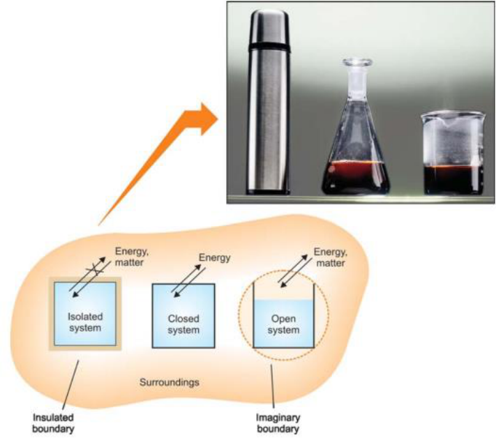{: .fig}

### 1.3 Homogeneous and Heterogeneous Systems

A system that is uniform throughout — consisting of a single phase, such as a pure gas, a pure liquid, or a true solution — is called a homogeneous system. A system consisting of two or more distinct

phases (e.g. ice in contact with water, or a solid in contact with its saturated solution and vapour) is heterogeneous.

### 1.4 Types of Thermodynamic Systems

Systems are classified according to whether their boundary permits the exchange of matter and/or energy with the surroundings:

|**System type **|**Matter exchange **|**Energy exchange **|**Example**|
|---|---|---|---|
|Isolated|No|No|Substance in an insulated, sealed thermos flask|
|Closed|No|Yes|Gas enclosed in a cylinder fitted with apiston|
|Open|Yes|Yes|Hot water in an open beaker; Zn + HCl in an open flask|

### 1.5 Intensive and Extensive Properties

Intensive properties do not depend on the quantity of matter present in the system, whereas extensive properties do, and are additive.

|**Intensiveproperties**|**Extensiveproperties**|
|---|---|
|Temperature, Pressure|Mass, Volume|
|Density, Refractive index|Number of moles|
|Viscosity, Surface tension|Internal energy (E)|
|Boiling point, Freezing point|Enthalpy (H), Entropy (S), Gibbs energy (G)|

A quick test: if you double the amount of substance in the system while holding T and P fixed, an extensive property doubles, while an intensive property is unchanged.

### 1.6 State of a System, State Functions and Path Functions

A thermodynamic system is said to be in a definite state when all its properties have fixed values. For a pure substance the composition is fixed automatically, and the remaining variables P, V, T are related through an equation of state, e.g. PV = nRT for an ideal gas. If any two of P, V, T are specified, the third is fixed automatically. Properties such as E, H, S and G depend only on the initial and final states of the system and not on the path by which the change is brought about — these are called state functions or state variables. In contrast, heat (q) and work (w) are path functions: their numerical values depend on exactly how a process is carried out between the same two states.

### 1.7 Equilibrium and Non-Equilibrium States

A system in which the state variables have the same, constant value throughout is said to be in thermodynamic equilibrium. Three separate conditions must be satisfied simultaneously:

1. Thermal equilibrium — the temperature is uniform throughout the system and equal to that of the surroundings.

2. Mechanical equilibrium — the pressure is uniform throughout, so that no part of the system does work on any other part.

3. Chemical equilibrium — the composition is uniform, with no net chemical change occurring. Thermodynamics, strictly, deals only with equilibrium states; a rapidly compressed gas, for instance, passes through non-equilibrium states in which pressure and temperature cannot be uniquely specified.

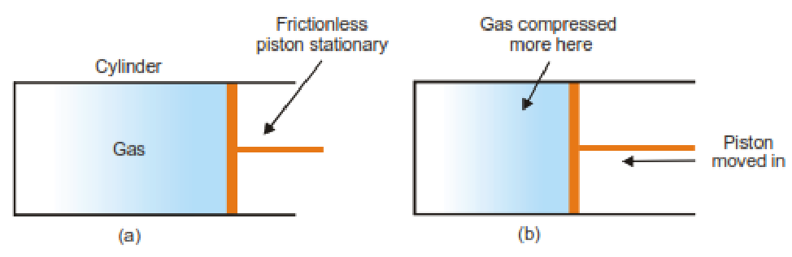{: .fig}

### 1.8 Thermodynamic Processes

|**Process**|**Condition held constant**|**Key relation**|
|---|---|---|
|Isothermal|Temperature|dT = 0|
|Adiabatic|No heat exchange|dq= 0|
|Isobaric|Pressure|dP = 0|
|Isochoric|Volume|dV = 0|
|Cyclic|System returns to initial state|ΔE = 0,ΔH = 0|

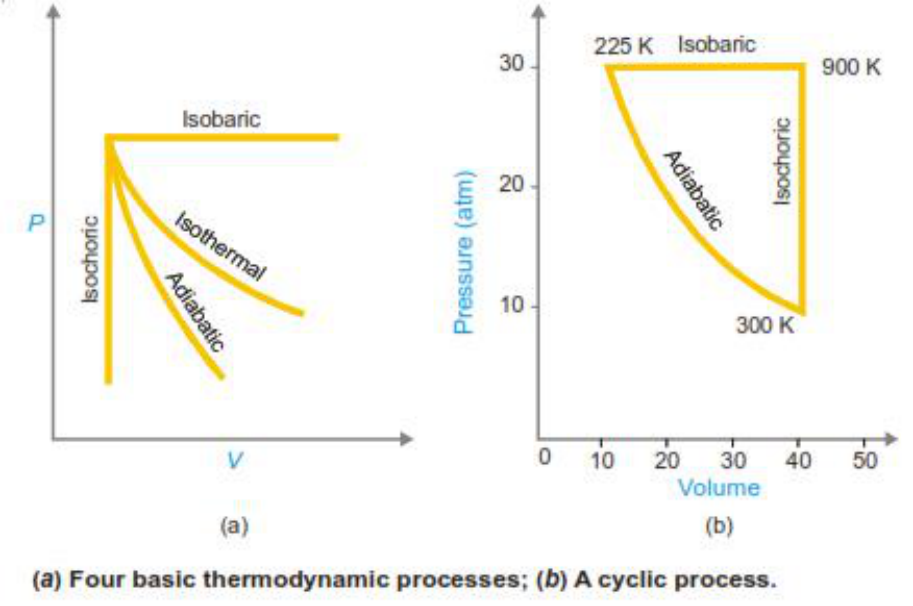{: .fig}

### 1.9 Reversible and Irreversible Processes

A thermodynamically reversible process proceeds through an infinite series of infinitesimally small steps, with the system remaining essentially in equilibrium at every stage; its direction can be reversed by an infinitesimal change in a state variable, and it is, in principle, infinitely slow. An irreversible process occurs in one or a few finite steps; the system is in equilibrium only at the initial and final states, and the process cannot be exactly reversed without permanent change to the surroundings.

|**Feature**|**Reversibleprocess**|**Irreversibleprocess**|
|---|---|---|
|Rate|Infinitelyslow(infinite steps)|Finite, measurable speed|
|Equilibrium|Maintained at everystage|Onlyat initial and final states|
|Practical realisation|Ideal / imaginarylimit|Real, actually performed|
|Work obtained(expansion)|Maximumpossible|Always less than reversible|

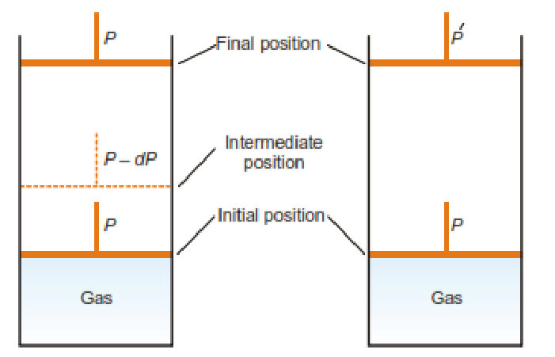{: .fig}

*(a) Reversible expansion occurs by decreasing the pressure on the piston by infinitesimal amounts. (b) Irreversible expansion occurs by a sudden decrease of pressure from P to P′, when the gas expands rapidly in a single operation.*

| Reversible process | Irreversible process |
|---|---|
| It takes place in an infinite number of infinitesimally small steps, and would take *infinite time* to occur. | It takes place in *finite time*. |
| It is *imaginary*, as it assumes the presence of a frictionless and weightless piston. | It is *real* and can be performed actually. |
| It is in equilibrium at *all stages* of the operation. | It is in equilibrium only at the *initial and final stages* of the operation. |
| All changes are *reversed* when the process is carried out in the reverse direction. | After this type of process has occurred, the changes *do not return* to the initial state by themselves. |
| It is extremely slow. | It proceeds at a *measurable speed*. |
| Work done by a reversible process is *greater* than that of the corresponding irreversible process. | Work done by an irreversible process is *smaller* than that of the corresponding reversible process. |

_Key idea: reversible work of expansion is always the maximum work obtainable between two given states — this single fact underlies the derivation of maximum work, free energy and the Carnot efficiency later in the syllabus._

### 1.10 Mathematical Tools for Thermodynamics

Thermodynamic quantities such as P, V and T are linked through an equation of state, and functions such as E, H, S, A and G each depend on more than one independent variable. To manipulate these relationships rigorously three mathematical tools are essential: partial derivatives, the test for an exact differential, and the cyclic rule.

#### 1.10.1 Partial Derivatives and the Total Differential

For a function z = z(x, y) of two independent variables, the partial derivative (∂z/∂x)y denotes the rate of change of z with x, holding y constant. The total differential of z collects both contributions:

dz = (∂z/∂x)y dx + (∂z/∂y)x dy = M dx + N dy

This form appears throughout thermodynamics — for example, for one mole of an ideal gas, V = V(T, P), so dV = (∂V/∂T)P dT + (∂V/∂P)T dP.

#### 1.10.2 Exact and Inexact Differentials

A differential dz = M dx + N dy is called exact if z is a true function of state — its value depends only on the initial and final states, never on the path taken between them. Internal energy (E), enthalpy (H), entropy (S), Helmholtz energy (A) and Gibbs energy (G) are all state functions, so dE, dH, dS, dA and dG are exact differentials. Heat (q) and work (w), by contrast, are path functions: their values depend on how a process is carried out, so đq and đw are inexact differentials (some texts write a stroke through the d, đ, to flag this). This is exactly why ΔE for a process can be found from the end states alone, while q and w individually cannot — only their difference, ΔE = q − w, is path-independent.

#### 1.10.3 Euler's Reciprocity Relation (Test for Exactness)

For dz = M dx + N dy to be exact, M and N must satisfy:

(∂M/∂y)x = (∂N/∂x)y

This is Euler's reciprocity relation, also called the condition for exactness. It follows because mixed second partial derivatives are independent of the order of differentiation, ∂²z/∂x∂y = ∂²z/∂y∂x. This is precisely the reciprocity condition used in Unit III (Section 10.2) to derive the four Maxwell relations from the four combined-law equations for dE, dH, dA and dG.

#### 1.10.4 The Cyclic Rule (Triple Product Rule)

For three variables x, y, z related by a single equation of state (so only two are independent), the cyclic rule states:

(∂x/∂y)z (∂y/∂z)x (∂z/∂x)y = −1

This lets one thermodynamic partial derivative be exchanged for others that may be easier to measure or compute, particularly when relating (∂P/∂T)V to more accessible quantities via the Clapeyron equation (Unit III, Section 5).

**Worked Example 1.1 — Verifying the Cyclic Rule for an Ideal Gas**

For one mole of an ideal gas, PV = RT. Verify the cyclic rule using P, V and T. From PV = RT: (∂P/∂V)T = −RT/V²,  (∂V/∂T)P = R/P,  (∂T/∂P)V = V/R.

Product = (−RT/V²)(R/P)(V/R) = −RT/(VP) = −RT/RT = −1, confirming the cyclic rule for any three variables connected by a single equation of state.

## 2. Work and Heat

Heat and work are the two ways in which energy crosses the boundary of a system. Both are path functions, meaning their values depend on how a process is carried out, not merely on the initial and final states.

### 2.1 Units of Heat and Work

Work is measured in joules (J); a commonly used larger unit is the kilojoule (1 kJ = 1000 J). Heat has traditionally been measured in calories, where 1 calorie is the heat needed to raise the temperature of 1 g of water by 1 °C near 15 °C. The SI unit for both heat and work is the joule, with the conversion 1 cal = 4.184 J.

### 2.2 Sign Conventions

|**Quantity**|**Positive convention**|**Negative convention**|
|---|---|---|
|Heat, q|Heat flows into the system (absorbed)|Heat flows out of the system (evolved)|
|Work, w|Work done by the system on surroundings (expansion)|Work done on the system by surroundings(compression)|

_This unit follows the classical (older, still widely used in Indian textbooks) convention ΔE = q − w, in which w denotes work done BY the system: work is positive when the system expands and does work on the surroundings, and negative when the surroundings do work on the system (compression). Some texts instead write ΔE = q + w with w defined as work done ON the system, in which the signs are reversed — always check which convention is in use before substituting values._

### 2.3 Pressure–Volume (P–V) Work

Consider a gas confined by a frictionless piston of cross-sectional area A. If the gas pushes the piston out through a distance l against a constant external pressure Pext, the force on the piston is f = Pext × A, and the work done:

$$
w = f \times l = P_{\text{ext}} \times A \times l = P_{\text{ext}} \times \Delta V
$$

Since the gas (system) does work on the surroundings during expansion, this work carries a positive sign under our convention (work done BY the system):

$$
w = +P_{\text{ext}}\,\Delta V \qquad \text{(expansion, work done by the system)}
$$

For compression, the piston moves inward and the sign of the work becomes negative (work done on the system by the surroundings, not by the system): w = −Pext ΔV.

### 2.4 Isothermal Reversible Work (Ideal Gas)

In a reversible isothermal expansion, the external pressure is reduced in a continuous series of infinitesimal steps, so that Pext is always only infinitesimally less than the gas pressure Pgas. The work done in one infinitesimal step is dw = P dV, and the total reversible work of expansion from V1 to V2 is:

$$
w = \int_{V_1}^{V_2} P\,dV = nRT \ln\frac{V_2}{V_1} = 2.303\, nRT \log\frac{V_2}{V_1}
$$

Since P1V1 = P2V2 for an isothermal process, V2/V1 = P1/P2, so the same result may be written in terms of pressures:

$$
w = 2.303\, nRT \log\frac{P_1}{P_2}
$$

### 2.5 Isothermal Irreversible Work

If the external pressure is instead dropped suddenly to its final value P2 and held there throughout the expansion, the work done by the gas is calculated using this constant P2 rather than the continuously varying internal pressure:

w = P2 (V2 − V1)

Because P2 is smaller than the internal pressure at every intermediate stage (except the final one), the irreversible work is always smaller in magnitude than the reversible work between the same two states — confirming that the reversible path yields the maximum work of expansion.

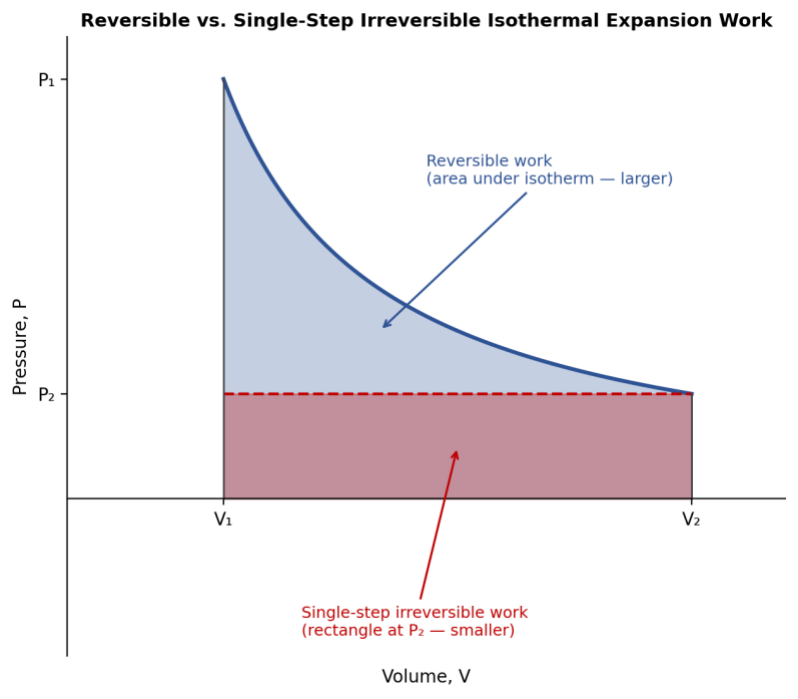{: .fig}

_Fig. 2.1 — Reversible (area under the isotherm) vs. single-step irreversible (rectangle at P₂) isothermal expansion work. The reversible path always does more work._

#### Worked Example 2.1 — Reversible isothermal expansion
{: .example}

One mole of an ideal gas expands reversibly and isothermally at 25 °C (298 K) from 10 L to 20 L. w = 2.303 × 8.314 × 298 × log(20/10) = 2.303 × 8.314 × 298 × 0.3010 = +1717.5 J

The positive sign shows work is done BY the gas on the surroundings; since ΔE = 0 (isothermal, ideal gas), q = w = +1717.5 J is absorbed.

#### Worked Example 2.2 — Irreversible expansion
{: .example}

The same gas (1 mol, 298 K) expands from 10 L to 20 L in a single step against a constant external pressure of 1 atm.

w = Pext ΔV = (1 atm)(10 L) = 10 L·atm = +1013.25 J (using 1 L·atm = 101.325 J)

Comparing with Example 2.1: \|wirr\| = 1013 J &lt; \|wrev\| = 1717.5 J, confirming reversible work is the maximum obtainable.

#### Worked Example 2.3 — Compression work
{: .example}

2 mol of an ideal gas is compressed isothermally and reversibly at 300 K from 40 L to 10 L. w = 2.303 × 2 × 8.314 × 300 × log(10/40) = 2.303 × 2 × 8.314 × 300 × (−0.602) = −6912 J

The negative sign shows that work is done ON the gas by the surroundings during compression (i.e. not by the gas itself).

## 3. First Law of Thermodynamics

### 3.1 Statement

The First Law of Thermodynamics is an application of the general law of conservation of energy to thermodynamic systems. It may be stated in several equivalent ways:

4. The total energy of an isolated system remains constant, although it may change from one form to another.

5. The total energy of a system and its surroundings remains constant (is conserved).

6. It is impossible to construct a perpetual-motion machine that performs work without consuming an equivalent amount of energy.

### 3.2 Internal Energy

Every system possesses a definite quantity of internal energy (E), comprising translational, rotational and vibrational molecular energies together with the kinetic and potential energies of the nuclei and electrons within the molecules. Internal energy is a state function and an extensive property; only the change, ΔE = Efinal − Einitial, can be measured — the absolute value cannot.

### 3.3 Mathematical Statement of the First Law

If a system absorbs heat q from the surroundings and, at the same time, does work w on the surroundings, the change in internal energy is:

ΔE = q − w

This equation may equivalently be stated: the net energy change of a closed system equals the heat transferred to the system minus the work done by the system.

### 3.4 Special Forms of the First Law

|**Condition**|**Simplification**|**Result**|
|---|---|---|
|Isochoric(constant V)|w = 0(no expansion work)|ΔE =qV|
|Adiabatic(q= 0)|no heat exchange|ΔE = −w|
|Cyclicprocess|ΔE = 0(state function returns to start)|q= w|
|Isobaric(constant P)|w = PΔV|ΔE =q− PΔV|

#### Worked Example 3.1 — Isobaric expansion
{: .example}

A gas absorbs 400 J of heat and expands from 5 L to 10 L against a constant pressure of 1 atm.

w = P(V2 − V1) = (1 atm)(5 L) = 5 L·atm = +506 J (using 1 L·atm = 101.2 J)

ΔE = q − w = 400 − 506 = −106 J. The gas does more work on the surroundings (506 J) than the heat it absorbs (400 J), so its internal energy falls.

#### Worked Example 3.2 — Adiabatic compression
{: .example}

A gas is compressed adiabatically, and 850 J of work is done ON the system by the surroundings. Since w denotes work done BY the system, and compression means the system is receiving work rather than doing it, w = −850 J.

Since the process is adiabatic, q = 0.

ΔE = q − w = 0 − (−850) = +850 J. The internal energy — and hence the temperature — of the gas increases.

#### Worked Example 3.3 — Cyclic process
{: .example}

An ideal gas undergoes a cyclic process consisting of an isothermal expansion followed by an adiabatic compression that restores the initial state.

Since the system returns to its initial state, ΔE = 0 for the complete cycle, so q(total) = w(total): the net heat absorbed over the whole cycle exactly equals the net work delivered.

#### Worked Example 3.4 — Vaporisation of water (irreversible constant-pressure change)
{: .example}

1 g of water at 373 K vaporises to steam at 1 atm; volume increases from negligible liquid volume to 1671 mL; heat of vaporisation = 540 cal/g.

w = P ΔV ≈ nRT = (1/18) × 1.987 × 373 = 41.2 cal/g (using ideal-gas approximation for the vapour)

ΔE = q − w = 540 − 41.2 = 498.8 cal/g

## 4. Enthalpy and Heat Capacities

### 4.1 Enthalpy

Most laboratory reactions are carried out at constant (atmospheric) pressure rather than constant volume. At constant pressure, part of any heat absorbed is used to perform expansion (PV) work, so a new state function — enthalpy, H — is defined as the total heat content of a system at constant pressure:

$$
H = E + PV
$$

Since E, P and V are all state functions, H must also be a state function, independent of path. For a finite change:

$$
\Delta H = \Delta E + \Delta(PV)
$$

At constant pressure, Δ(PV) = PΔV, so ΔH = ΔE + PΔV = ΔE + w. Combining this with the First Law (ΔE = q − w) gives the important practical result:

$$
\Delta H = q_P \qquad \text{(heat absorbed at constant pressure)}
$$

Thus ΔH can be measured simply by measuring the heat evolved or absorbed in a process carried out at constant pressure. ΔH is positive for an endothermic process (H2 > H1) and negative for an exothermic process (H1 > H2).

### 4.2 Molar Heat Capacities

The molar heat capacity is the quantity of heat required to raise the temperature of one mole of a substance by 1 K. Because heat is a path function, the value of the heat capacity depends on the conditions under which heating occurs; the two most important are Cv (constant volume) and Cp (constant pressure):

$$
C_v = \left(\frac{\partial E}{\partial T}\right)_V \qquad C_p = \left(\frac{\partial H}{\partial T}\right)_P
$$

Thus Cv is the rate of change of internal energy with temperature at constant volume, while Cp is the rate of change of enthalpy with temperature at constant pressure. Both are expressed in cal K⁻¹ mol⁻¹ or, in SI units, J K⁻¹ mol⁻¹.

### 4.3 Relation between Cp and Cv

From the First Law, dq = dE + PdV. Dividing throughout by dT: dq/dT = dE/dT + P(dV/dT). At constant volume this reduces to Cv = (dE/dT)v. For one mole of an ideal gas, H = E + RT (since PV = RT); differentiating with respect to temperature at constant pressure:

**_dH/dT = dE/dT + R_** ⟹ **_Cp = Cv + R_** ⟹ **_Cp − Cv = R_**

Cp is always greater than Cv because, at constant pressure, part of the heat absorbed by the system performs expansion work in addition to raising the temperature; at constant volume, the entire heat absorbed goes into raising the temperature (internal energy) alone.

### 4.4 Calculation of ΔE and ΔH for an Ideal Gas

Since Cv = dE/dT, for a finite temperature change from T1 to T2 (n moles):

$$
\Delta E = n\,C_v\,(T_2 - T_1)
$$

Similarly, since ΔH = ΔE + RΔT = Cv(T2 − T1) + R(T2 − T1) = (Cv + R)(T2 − T1) = Cp(T2 − T1): **_ΔH = n Cp (T2 − T1)_**

#### Worked Example 4.1 — Heating a gas
{: .example}

Calculate ΔE and ΔH on heating 64.0 g (4 mol) of O 2 from 0 °C to 100 °C (Cv = 5.0, Cp = 7.0 cal mol ⁻ ¹ K ⁻ ¹). ΔE = 4 × 5.0 × 100 = 2000 cal;   ΔH = 4 × 7.0 × 100 = 2800 cal

#### Worked Example 4.2 — Heat capacity of water
{: .example}

Heat required to raise 213.5 g (≈11.86 mol) of water from 25 °C to 100 °C; molar Cp(water) = 18 cal mol⁻¹ K ⁻ ¹.

q = nCp(T2 − T1) = 11.86 × 18 × 75 = 16 011 cal ≈ 16.01 kcal

#### Worked Example 4.3 — ΔE and ΔH with different Cv and Cp
{: .example}

3 mol of an ideal gas (Cv = 5 cal K ⁻ ¹ mol ⁻ ¹, R = 2 cal K ⁻ ¹ mol ⁻ ¹) go from 10.0 atm, 0 °C to 2.0 atm, 50 °C. ΔE = nCv ΔT = 3 × 5 × 50 = 750 cal

ΔH = nCp ΔT = n(Cv + R) ΔT = 3 × 7 × 50 = 1050 cal

### 4.5 The Joule–Thomson Effect

The apparatus used by Joule and Thomson to measure the temperature change on expansion of a given volume of gas is illustrated in Fig. 4.1. An insulated tube is fitted with a porous plug in the middle and two frictionless pistons A and B on the sides. Let a volume V1 of a gas at pressure P1 be forced through the porous plug by a slow movement of piston A. The gas in the right-hand chamber is allowed to expand to volume V2 and pressure P2 by moving the piston B outward. The change in temperature is found by taking readings on the two thermometers.

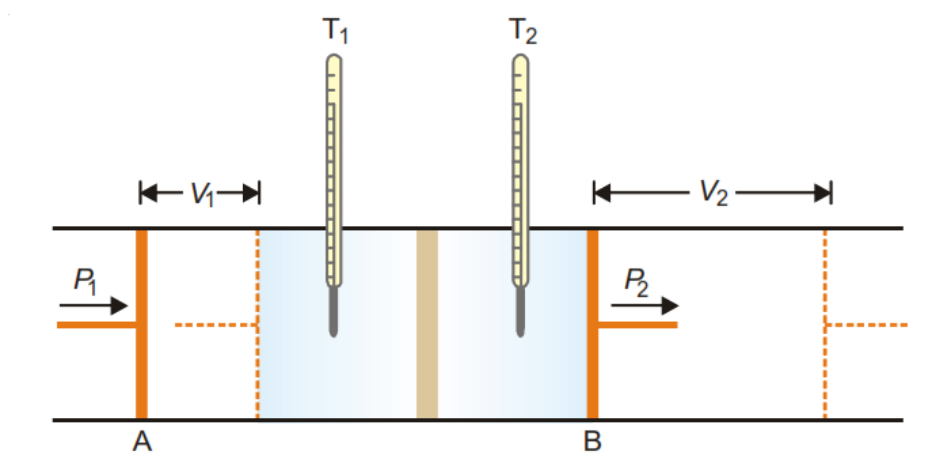{: .fig}

_Fig. 4.1 — Joule–Thomson throttling: a real gas is forced through a porous plug or throttle valve from high pressure to low pressure under adiabatic, constant-enthalpy conditions._

Most gases were found to undergo cooling on expansion through the porous plug. Hydrogen and helium were exceptions as these gases showed a warming up instead of cooling.

Explanation. The work done on the gas at the piston A is P1V1 and the work done by the gas at the piston B is P2V2. Hence the net work (w) done by the gas is

$$
w = P_2V_2 - P_1V_1
$$

$$
\Delta E = q - w \qquad \text{(First Law)}
$$

But the process is adiabatic and, therefore, q = 0

$$
\therefore\ \Delta E = E_2 - E_1 = -w = -(P_2V_2 - P_1V_1)
$$

$$
\text{or}\quad E_2 - E_1 = -(P_2V_2 - P_1V_1)
$$

Rearranging,

E2 + P2V2= E1 + P1V1

H2= H1 or ΔH = 0

Thus the process in Joule-Thomson experiment takes place at constant enthalpy.

#### Joule-Thomson Coefficient

The number of degree temperature change produced per atmosphere drop in pressure under constant enthalpy conditions on passing a gas through the porous plug, is called Joule-Thomson coefficient. It is represented by the symbol μ. Thus,

$$
\mu = \frac{dT}{dP}
$$

If μ is positive, the gas cools on expansion; if μ is negative, the gas warms on expansion. The temperature at which the sign changes is called the **Inversion temperature** . Most gases have positive Joule-Thomson coefficients and hence they cool on expansion at room temperature. Thus liquefaction of gases is accomplished by a succession of Joule-Thomson expansion.

The inversion temperature for H2 is –80ºC. Above the inversion temperature, μ is negative. Thus at room temperature hydrogen warms on expansion. Hydrogen must first be cooled below –80ºC (with liquid nitrogen) so that it can be liquefied by further Joule-Thomson expansion. So is the case with helium.

#### Explanation of Joule-Thomson Effect

We have shown above that Joule-Thomson expansion of a gas is carried at constant enthalpy.

But

$$
H = E + PV
$$

Since H remains constant, any increase in PV during the process must be compensated by decrease of E, the internal energy. This leads to a fall in temperature i.e., T2 < T1. For hydrogen and helium PV decreases with lowering of pressure, resulting in increase of E and T2 > T1. Below the inversion temperature, PV increases with lowering of pressure and cooling is produced.

Throttling is therefore an isoenthalpic process (constant H) — even though it is irreversible and cannot be plotted as a smooth curve on a P–V diagram. The Joule–Thomson coefficient measures how much the temperature changes for a given drop in pressure at constant enthalpy:

$$
\mu_{JT} = \left(\frac{\partial T}{\partial P}\right)_H
$$

Using the cyclic rule (Section 1.10.4) with x = T, y = P, z = H, and noting that (∂H/∂T)P = Cp, this coefficient can be re-expressed in terms of more accessible quantities:

#### Setup

We want (∂T/∂P)H — how temperature changes with pressure at constant enthalpy. Since H is a state function of T and P, and only two of {T, P, H} are truly independent (H is fixed by whichever two of T, P you pick), the cyclic rule applies to this triple with x = T, y = P, z = H:

$$
\left(\frac{\partial T}{\partial P}\right)_H \left(\frac{\partial P}{\partial H}\right)_T \left(\frac{\partial H}{\partial T}\right)_P = -1
$$

#### Step 1 — Isolate the term you want

Divide both sides by the two factors you don't want, leaving (∂T/∂P)H on its own:

$$
\left(\frac{\partial T}{\partial P}\right)_H = \frac{-1}{\left(\partial P/\partial H\right)_T \left(\partial H/\partial T\right)_P}
$$

#### Step 2 — Deal with the awkward middle factor

(∂P/∂H)T is inconvenient because nobody tabulates “pressure as a function of enthalpy.” But at constant T, P and H vary together through one relationship, so this partial derivative obeys the ordinary reciprocal rule — exactly like dy/dx = 1/(dx/dy) for single-variable calculus:

$$
\left(\frac{\partial P}{\partial H}\right)_T = \frac{1}{\left(\partial H/\partial P\right)_T}
$$

#### Step 3 — Substitute back

$$
\left(\frac{\partial T}{\partial P}\right)_H = -\frac{\left(\partial H/\partial P\right)_T}{\left(\partial H/\partial T\right)_P}
$$

#### Step 4 — Recognize Cp

By definition, (∂H/∂T)P = Cp. Substituting gives the final result:

$$
\mu_{JT} = \left(\frac{\partial T}{\partial P}\right)_H = -\frac{1}{C_p}\left(\frac{\partial H}{\partial P}\right)_T
$$

Why it's useful: the left side, (∂T/∂P)H, would require measuring temperature changes during throttling directly — awkward and imprecise. The right side needs only Cp (tabulated for virtually every gas) and (∂H/∂P)T, which can be obtained theoretically from an equation of state such as van der Waals' — quantities that are far easier to get your hands on.

#### Sanity check — an independent route

Start from the total differential of H(T, P), and set dH = 0 along the isenthalpic (throttling) path:

$$
dH = C_p\,dT + \left(\frac{\partial H}{\partial P}\right)_T dP = 0
$$

Rearranging directly gives:

$$
\left(\frac{dT}{dP}\right)_H = -\frac{1}{C_p}\left(\frac{\partial H}{\partial P}\right)_T
$$

_Same answer as the cyclic-rule route — confirming no error was introduced. This two-method derivation also appears in Unit II, Section 4.5, of the course notes._

$$
\mu_{JT} = \left(\frac{\partial T}{\partial P}\right)_H = -\frac{1}{C_p}\left(\frac{\partial H}{\partial P}\right)_T
$$

For an ideal gas, H depends on temperature alone, so (∂H/∂P)T = 0 and μJT = 0 identically — an ideal gas neither warms nor cools on free throttling. The Joule–Thomson effect is thus a direct, measurable signature of intermolecular forces in a real gas: it is exactly the term the ideal-gas model leaves out.

The sign of μJT depends on both the gas and the temperature. Since pressure always falls across the plug (dP < 0), the sign of dT is opposite to the sign of μJT’s effect on falling P: when μJT > 0 the gas cools on expansion (used for liquefaction); when μJT < 0 the gas warms on expansion. The temperature at which μJT changes sign is the inversion temperature; below it, throttling cools the gas, and above it, throttling heats the gas.

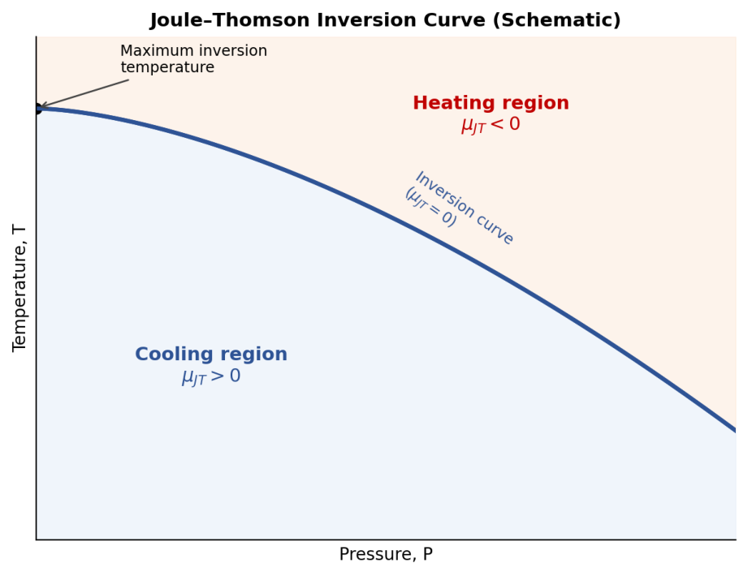{: .fig}

_Fig. 4.2 — The Joule–Thomson inversion curve (schematic): below the curve the gas cools on throttling (μJT > 0, used in gas liquefaction); above it, the gas warms (μJT < 0)._

#### Worked Example 4.4 — Why hydrogen must be pre-cooled before liquefaction
{: .example}

The (maximum) inversion temperatures of N 2 and H 2 are approximately 621 K and 202 K respectively. Predict what happens when each gas is throttled starting at room temperature, 300 K. For N 2 : 300 K < 621 K, so N 2 is below its inversion temperature — μJT > 0 and the gas cools on throttling, exactly as required for Linde’s liquefaction process to work directly.

For H 2 : 300 K > 202 K, so H 2 is above its inversion temperature — μJT < 0 and the gas warms on throttling instead of cooling. H 2 (and He, with an even lower inversion temperature) must first be pre-cooled below its inversion temperature — typically using liquid nitrogen — before Joule–Thomson expansion can be used to liquefy it.

## 5. Gas Expansion — Isothermal and Adiabatic Processes

### 5.1 Isothermal Reversible Expansion

For an ideal gas undergoing an isothermal process, temperature — and hence internal energy — remains constant, so ΔE = 0. From the First Law, q = w, and the work of reversible isothermal expansion (Section 2.4) equals the heat absorbed:

q = w = nRT ln(V2/V1) = 2.303 nRT log(P1/P2)

Since ΔE = 0, it also follows that ΔH = ΔE + Δ(PV) = 0 for an isothermal process in an ideal gas (as PV = nRT is constant at fixed T).

### 5.2 Adiabatic Reversible Expansion

In an adiabatic process no heat is exchanged (q = 0), so from the First Law, ΔE = −w: the work of expansion is done entirely at the expense of the internal energy, and the gas necessarily cools. For an infinitesimal reversible step, dE = −PdV, and since dE = Cv dT for an ideal gas:

$$
C_v\,dT = -P\,dV = -\frac{RT}{V}\,dV
$$

Separating variables and integrating between (T1, V1) and (T2, V2), with Cv constant:

$$
C_v \ln\frac{T_2}{T_1} = -R \ln\frac{V_2}{V_1}
$$

Using R = Cp − Cv and defining γ = Cp/Cv, this rearranges to the standard adiabatic relations:

$$
TV^{\gamma-1} = \text{constant} \qquad PV^{\gamma} = \text{constant} \qquad T\,P^{(1-\gamma)/\gamma} = \text{constant}
$$

Because these differ from Boyle's Law (PV = constant, isothermal) by the extra exponent γ (> 1), the adiabatic P–V curve is always steeper than the isothermal curve at any given point — for the same drop in pressure, an adiabatic expansion produces a smaller increase in volume, since part of the driving force for expansion is lost as the temperature itself falls.

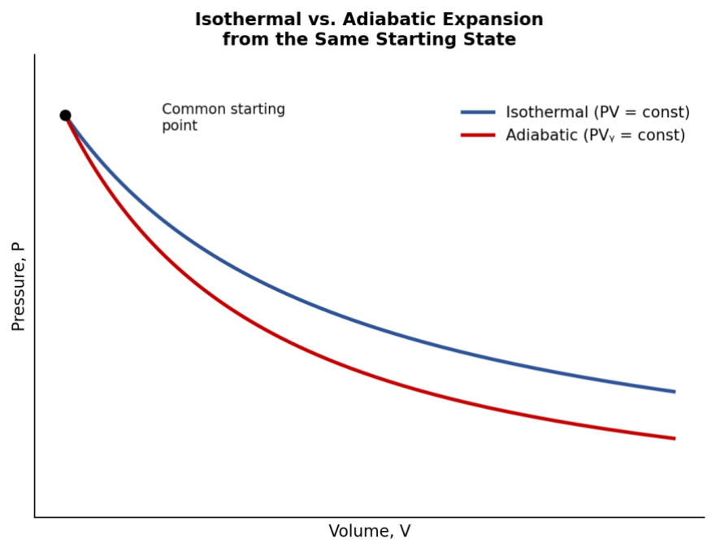{: .fig}

_Fig. 5.1 — Isothermal and adiabatic expansion from the same starting state: the adiabat is always the steeper curve._

### 5.3 Work Done in Adiabatic Reversible Expansion

Since ΔE = −w and ΔE = nCv(T2 − T1) for n moles:

w(max, adiabatic) = n Cv (T1 − T2) = nR(T1 − T2)/(γ − 1)

When T2 < T1 (expansion, cooling), w is positive — work is done BY the gas. When T2 > T1 (compression, heating), w is negative — work is done ON the gas.

#### Worked Example 5.1 — Adiabatic reversible expansion
{: .example}

2 mol of an ideal gas at 273.2 K, 20 atm expand adiabatically and reversibly to 2 atm (Cp/Cv = γ = 5/3). (T2/273.2) = (P2/P1)^[(γ−1)/γ] = (2/20)^(2/5) ⟹ T2 ≈ 108.8 K w = nCv(T1 − T2) = 2 × (3/2)(8.314)(273.2 − 108.8) ≈ 4100 J = 4.1 kJ (done BY the gas)

#### Worked Example 5.2 — Adiabatic expansion of air
{: .example}

Dry air at NTP (1 atm, 273 K) expands adiabatically and reversibly from 1 L to 5 L (Cp/Cv = 1.4). Using T1V1ᵞ ⁻ ¹ = T2V2ᵞ ⁻ ¹: T2 = T1 (V1/V2)^0.4 = 273 × (1/5)^0.4 ≈ 143.3 K P2 = P1(V1/V2)ᵞ = 1 × (1/5)^1.4 ≈ 0.105 atm — both temperature and pressure fall sharply.

### 5.4 Isothermal Irreversible Expansion

If the pressure is dropped in a single step to the final value P2, the gas does work against this constant P2 throughout, even though its own pressure is initially much higher:

w = P2 (V2 − V1)

Because this work is done against a smaller effective opposing pressure than in the reversible case (where Pext continuously tracks Pgas), irreversible isothermal work is always less than the reversible isothermal work between the same limits.

### 5.5 Comparative Summary

|**Feature**|**Isothermal**|**Adiabatic**|
|---|---|---|
|Heat exchange|q≠ 0(heat absorbed = work done)|q= 0|
|Temperature|Constant|Falls(expansion)/ rises(compression)|
|ΔE|0(idealgas)|= −w ≠ 0|
|Governinglaw|PV = constant(Boyle's Law)|PVᵞ = constant|
|Slope on P–V diagram|Less steep|Steeper|

## 6. Thermochemistry

Thermochemistry is the study of the heat changes that accompany chemical reactions and physical transformations. A reaction that evolves heat (Hproducts < Hreactants, ΔH negative) is exothermic; one that absorbs heat (Hproducts > Hreactants, ΔH positive) is endothermic.

**Real-World Application: Hot and Cold Packs**

_Instant cold packs (used for sports injuries) contain solid ammonium nitrate, NH4NO3, separated from water by an internal membrane. Breaking the pack mixes them; because NH4NO3(s) → NH4⁺(aq) + NO3⁻(aq) is endothermic (ΔHsoln ≈ +25.7 kJ mol⁻¹), the pack draws heat from its surroundings — your skin — and feels cold. Instant hot packs typically use anhydrous calcium chloride, CaCl2, whose dissolution is strongly exothermic (ΔHsoln ≈ −82.8 kJ mol⁻¹), releasing heat instead. (A different type of hand warmer, using supersaturated sodium acetate, works by crystallisation rather than dissolution — releasing the substance’s heat of fusion when triggered by a metal clicker.) ΔH > 0 absorbs heat from the surroundings (feels cold); ΔH < 0 releases heat to the surroundings (feels hot)._

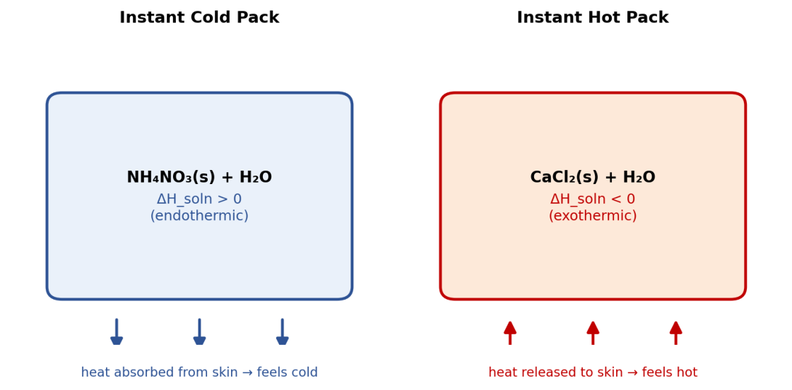{: .fig}

_Fig. 6.4 — Instant cold and hot packs: everyday demonstrations of endothermic and exothermic dissolution enthalpy._

### 6.1 Relation between ΔH and ΔE for a Reaction

For a gas-phase (or gas-involving) reaction in which the number of moles of gas changes from n1 (reactants) to n2 (products), the volume change is almost entirely due to the gaseous species (solids and liquids contribute negligible volume change). Using PV = nRT:

$$
\Delta H = \Delta E + \Delta n\,RT, \qquad \text{where } \Delta n = n_2 - n_1
$$

If Δn = 0 (no change in the number of gas moles), ΔH = ΔE.

**Worked Example 6.1 — ΔH from ΔE**

For H 2 F 2 (g) → H 2 (g) + F 2 (g), ΔE = −14.2 kcal mol ⁻ ¹ at 25 °C. Δn = 2 − 1 = 1. ΔH = ΔE + ΔnRT = −14.2 + (1)(1.987 × 10⁻³)(298) = −14.2 + 0.592 = −13.6 kcal mol⁻¹

### 6.2 Standard Enthalpy of Formation

The standard enthalpy of formation, ΔHf°, is the enthalpy change when one mole of a compound is formed from its constituent elements, with every substance in its standard state (298 K, 1 atm pressure, most stable physical form). By convention, ΔHf° for every element in its standard state is zero. The standard enthalpy of any reaction can then be obtained from tabulated formation values:

$$
\Delta H^\circ = \sum \Delta H_f^\circ(\text{products}) - \sum \Delta H_f^\circ(\text{reactants})
$$

A representative selection of standard enthalpies of formation (at 298 K) is given below.

|**Substance**|**ΔHf° / kcal mol⁻¹**|
|---|---|
|H2O(g)|−57.84|
|H2O(l)|−68.38|
|CO2(g)|−94.13|
|CO(g)|−26.4|
|NH3(g)|−11.02|
|CH4(g)|−17.89|
|C2H2(g)|+53.14|
|C6H6(g)|+11.86|

#### Worked Example 6.2 — Standard enthalpy of reaction
{: .example}

For CO 2 (g) + H 2 (g) → CO(g) + H 2 O(g); ΔHf°(CO 2 ) = −393.5, ΔHf°(CO) = −111.3, ΔHf°(H 2 O,g) = −241.8 kJ mol ⁻ ¹.

ΔH° = [(−111.3) + (−241.8)] − [(−393.5) + 0] = −353.1 + 393.5 = +40.4 kJ (endothermic)

### 6.3 Hess's Law of Constant Heat Summation

Because ΔH (and ΔE) are state functions, the total heat change of a reaction is the same whether it occurs in a single step or through any number of intermediate steps. This generalisation is Hess's Law: if a chemical change can be brought about in two or more different ways, the total enthalpy change is identical regardless of the path. Consequently, thermochemical equations may be added, subtracted or multiplied by constants exactly like ordinary algebraic equations, which makes Hess's Law extremely useful for obtaining enthalpies of formation, combustion or transition that cannot be measured directly.

#### Worked Example 6.3 — Indirect determination of ΔHf(CO)
{: .example}

The formation reaction C(graphite) + ½O2(g) → CO(g) cannot be measured directly — burning carbon in a limited supply of oxygen always yields some CO2 alongside the CO, so the heat measured is never that of a clean, single reaction. Both the combustion of carbon and the combustion of carbon monoxide, however, run cleanly to completion and are easily measured:

(2) C(graphite) + O2(g) → CO2(g),  ΔH2 = −393.5 kJ mol ⁻ ¹

(3) CO(g) + ½O2(g) → CO2(g),  ΔH3 = −283.0 kJ mol ⁻ ¹ Reaction (1), the target, plus reaction (3) gives reaction (2) — that is, ΔH2 = ΔH1 + ΔH3 — so: ΔH1 = ΔH2 − ΔH3 = −393.5 − (−283.0) = −110.5 kJ mol⁻¹

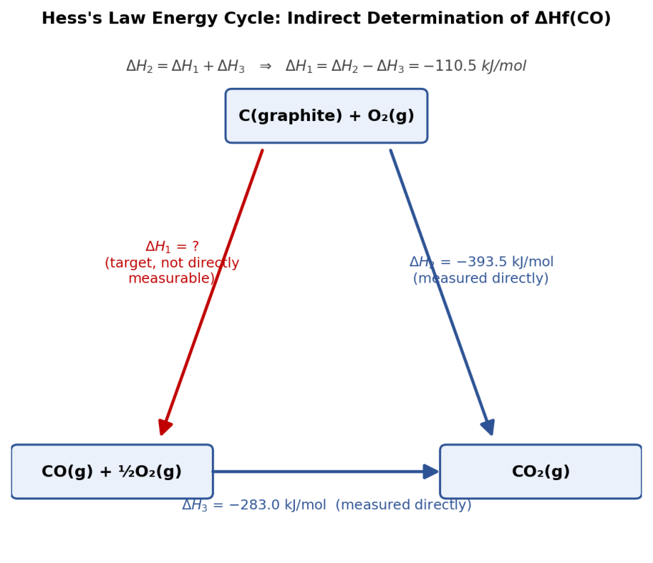{: .fig}

_Fig. 6.1 — Hess's Law energy cycle for the indirect determination of ΔHf(CO), using the measurable combustion enthalpies of carbon and of carbon monoxide._

This is the general strategy behind every Hess’s-Law calculation: arrange the known, directlymeasurable reactions so that adding (or subtracting) them algebraically reproduces the target equation exactly, then apply the same addition/subtraction to their ΔH values.

#### Cross-reference: The Born–Haber Cycle

The same principle — building an inaccessible enthalpy from a cycle of measurable steps. For NaCl, the standard enthalpy of formation is built from five steps: sublimation of Na(s), dissociation of ½Cl2(g), ionisation of Na(g), electron gain by Cl(g), and finally lattice formation from the gaseous ions. Because enthalpy is a state function, the sum of these five steps must equal the directly-measured ΔHf°(NaCl) — which is exactly how the otherwise-unmeasurable lattice energy is obtained by difference.

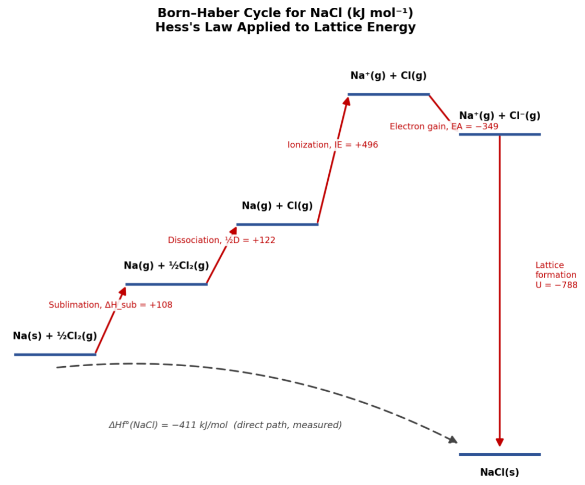{: .fig}

_Fig. 6.2 — The Born–Haber cycle for NaCl: another application of Hess's Law, used to obtain lattice energy from otherwiseinaccessible steps_

#### Worked Example 6.4 — Enthalpy of formation of propane
{: .example}

Given: C(s)+O 2 →CO 2 , ΔH=−393.5 kJ; H 2 +½O 2 →H 2 O(l), ΔH=−285.8 kJ; C 3 H 8 (g)+5O 2 →3CO 2 +4H 2 O(l), ΔHc=−2220.2 kJ.

Target: 3C(s) + 4H 2 (g) → C 3 H 8 (g). Combine 3×(eq.1) + 4×(eq.2) − (eq.3): ΔH f (C 3 H 8 ) = 3(−393.5) + 4(−285.8) − (−2220.2) = −1180.5 − 1143.2 + 2220.2 = −103.5 kJ mol⁻¹

#### Worked Example 6.5 — Enthalpy of formation of ethyl alcohol
{: .example}

Heat of combustion of C 2 H 5 OH(l) = −330.0 kcal; ΔHf°(CO 2 ) = −94.3, ΔHf°(H 2 O,l) = −68.5 kcal mol ⁻ ¹. C 2 H 5 OH + 3O 2 → 2CO 2 + 3H 2 O, ΔH = −330.0 kcal.

ΔHf(C2H5OH) = [2(−94.3) + 3(−68.5)] − (−330.0) = (−188.6 − 205.5) + 330.0 = −64.1 kcal mol⁻¹

#### Worked Example 6.6 — Enthalpy of transition (allotropes)
{: .example}

Srhombic + O 2 → SO 2 , ΔH = −291.4 kJ;   Smonoclinic + O 2 → SO 2 , ΔH = −295.4 kJ. Subtracting: Srhombic → Smonoclinic, ΔH = −291.4 − (−295.4) = +4.0 kJ (heat of transition)

### 6.4 Dependence of Enthalpy of Reaction on Temperature — Kirchhoff's Equation

The heat capacities of reactants and products are generally different, so the enthalpy of a reaction itself varies with temperature. Differentiating ΔH = H(products) − H(reactants) with respect to temperature at constant pressure:

d(ΔH)/dT = ΔCp,     where ΔCp = ΣCp(products) − ΣCp(reactants)

Integrating between T1 and T2, treating ΔCp as constant over this range, gives the integrated form of Kirchhoff's equation:

ΔH2 − ΔH1 = ΔCp (T2 − T1)

An exactly analogous relation applies at constant volume: ΔE2 − ΔE1 = ΔCv(T2 − T1). Kirchhoff's equation is used to calculate the enthalpy of a reaction at one temperature from its known value at another, given the heat capacities of the reactants and products.

#### Worked Example 6.7 — Kirchhoff's equation
{: .example}

ΔH for ½H 2 + ½Cl 2 → HCl at 300 K is −22.1 kcal. Cp(H 2 , Cl 2 , HCl) = 6.82, 7.70, 6.80 cal mol ⁻ ¹ K ⁻ ¹. ΔCp = 6.80 − ½(6.82 + 7.70) = 6.80 − 7.26 = −0.46 cal K ⁻ ¹ ΔH(350 K) = −22.1 + (−0.46 × 10⁻³)(50) = −22.123 kcal

#### Worked Example 6.8 — Kirchhoff's equation (second case)
{: .example}

ΔH for N 2 + 3H 2 → 2NH 3 at 300 K is −21.976 kcal. Cp(N 2 , H 2 , NH 3 ) = 6.8, 6.77, 8.86 cal mol ⁻ ¹ K ⁻ ¹. ΔCp = 2(8.86) − [6.8 + 3(6.77)] = 17.72 − 27.11 = −9.39 cal K ⁻ ¹ ΔH(323 K) = −21.976 + (−9.39 × 10⁻³)(23) = −22.192 kcal

### 6.5 Other Standard Enthalpy Changes

Several other named enthalpy changes are routinely used alongside the enthalpy of formation:

- Heat of combustion (ΔHc): enthalpy change when one mole of a substance is completely burnt in excess oxygen; always negative.

- Heat of solution: enthalpy change when one mole of a solute dissolves in a specified (or infinite) quantity of solvent.

- Heat of neutralisation: enthalpy change when one gram-equivalent of an acid reacts with one gram-equivalent of a base in dilute solution; for any strong acid–strong base pair this is essentially constant (≈ −13.7 kcal), representing simply H⁺(aq) + OH⁻(aq) → H2O(l).

- Heat of fusion, vaporisation and sublimation: enthalpy changes accompanying the solid→liquid, liquid→gas and solid→gas transitions respectively, each measured at the corresponding transition temperature.

#### Worked Example 6.9 — Heat of combustion and calorific value
{: .example}

ΔHc(CH 4 ,g) = −890.3 kJ mol ⁻ ¹ (M = 16 g mol ⁻ ¹); ΔHc(C 2 H 6 ,g) = −1559.7 kJ mol ⁻ ¹ (M = 30 g mol ⁻ ¹). Calorific value (heat per gram): CH 4 → 890.3/16 = 55.6 kJ g ⁻ ¹;  C 2 H 6 → 1559.7/30 = 52.0 kJ g ⁻ ¹. Methane has the higher fuel efficiency per unit mass.

### 6.6 Measurement of Heat of Reaction — Calorimetry

The tabulated ΔHf° and ΔHc values used throughout this section are experimentally determined, not assumed — by calorimetry, the measurement of heat exchanged during a reaction. Two standard methods are used, depending on whether the reaction is run at constant volume or constant pressure.

#### 6.6.1 Bomb Calorimetry (Constant Volume)

A weighed sample is burnt inside a sealed, rigid steel vessel (the "bomb"), pressurised with excess oxygen and immersed in a known mass of water within an insulated jacket. Because the vessel is rigid, its volume cannot change, so no P–V work is possible (w = 0), and the First Law reduces to:

qv = ΔE

The heat released raises the temperature of the water bath and the calorimeter assembly; if the total heat capacity of the assembly, Ccal, has been predetermined (typically by burning a standard sample

of known ΔE, such as benzoic acid), the heat released by the reaction follows from the observed temperature rise:

qv = Ccal × ΔT

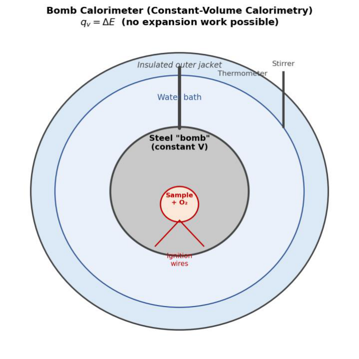{: .fig}

_Fig. 6.3 — A bomb calorimeter: the reaction occurs inside a sealed, rigid steel vessel of fixed volume, so no P–V work is possible and qv = ΔE directly._

#### 6.6.2 Constant-Pressure Calorimetry

Many reactions — particularly in solution, such as acid–base neutralisation or dissolution — are instead studied in a simple insulated ("coffee-cup") calorimeter open to the atmosphere, at constant pressure. Here P–V work is allowed, and the heat measured is directly the enthalpy change:

qP = ΔH = (mass of solution) × (specific heat) × ΔT

#### 6.6.3 Converting Between ΔE and ΔH

Since bomb calorimetry gives ΔE directly while most tabulated thermochemical data are quoted as ΔH, the two must be interconverted using the relation already established in Section 6.1:

ΔH = ΔE + Δn(gas) RT

where Δn(gas) is the change in the number of moles of gas between products and reactants. This correction is usually small compared with ΔE itself, but it is not negligible for precise work, and ignoring it is a common source of error in this type of calculation.

#### Worked Example 6.10 — Bomb calorimetry: combustion of methane
{: .example}

0.500 g of methane (M = 16 g mol⁻¹) is burnt completely in a bomb calorimeter of total heat capacity 11.30 kJ K⁻¹. The temperature of the assembly rises by 2.20 °C. Calculate ΔE and ΔH per mole for CH4(g) + 2O2(g) → CO2(g) + 2H2O(l) at 298 K.

Moles of CH4 burnt = 0.500/16 = 0.03125 mol Heat released, qv = Ccal × ΔT = 11.30 × 2.20 = 24.86 kJ ΔE (per mole, exothermic) = −24.86/0.03125 = −795.5 kJ mol ⁻ ¹

Δn(gas) = (1 mol CO2) − (1 mol CH4 + 2 mol O2) = 1 − 3 = −2   (H2O is liquid, so it does not count) ΔnRT = (−2)(8.314 × 10 ⁻ ³ kJ K ⁻ ¹ mol ⁻ ¹)(298 K) = −4.96 kJ mol ⁻ ¹ ΔH = ΔE + ΔnRT = −795.5 + (−4.96) = −800.4 kJ mol ⁻ ¹

Note that ΔH is more negative than ΔE here — because the gas moles decrease (Δn < 0), the surroundings do a small amount of work compressing the system as it reacts, adding to the heat released at constant pressure.

## 7. Bond Energies and Bond Dissociation Enthalpies

The bond dissociation enthalpy is the enthalpy required to break one specific bond in a particular molecule, producing gaseous fragments. Because the dissociation enthalpy of a given type of bond (e.g. C–H) varies slightly from molecule to molecule, the bond energy is defined as the average bond dissociation enthalpy of that bond type, taken over a representative set of molecules — for instance, the bond energy of the C–H bond is obtained by averaging the four successive C–H dissociation enthalpies in methane.

### 7.1 Representative Bond Energies

|**Bond**|**Bond energy / kJ mol⁻¹**|
|---|---|
|H–H|433|
|Cl–Cl|243|
|O=O|499|
|C–H|414|
|O–H|460|
|C=C|619|
|C=O|724|

### 7.2 Estimating Reaction Enthalpy from Bond Energies

For a gas-phase reaction, an approximate enthalpy of reaction can be estimated as the energy needed to break all bonds in the reactants minus the energy released on forming all bonds in the products:

ΔH(reaction) ≈ Σ(bond energies broken, reactants) − Σ(bond energies formed, products)

This method is approximate because tabulated bond energies are averages over many compounds, but it is invaluable when direct thermochemical data are unavailable, and it also underlies the estimation of the strength (and hence reactivity) of individual bonds.

#### Worked Example 7.1 — Enthalpy of a hydrogenation-type reaction
{: .example}

For H 2 (g) + ½O 2 (g) → H 2 O(g); E(H–H)=104, E(O=O)=118, E(O–H)=111 kcal mol ⁻ ¹ (older data set). ΔH = [bonds broken] − [bonds formed] = [104 + ½(118)] − [2×111] = 163 − 222 = −59 kcal mol⁻¹

#### Worked Example 7.2 — Combustion of ethylene
{: .example}

For C 2 H 4 (g) + 3O 2 (g) → 2CO 2 (g) + 2H2O(g); bond energies (kJ mol⁻¹): C–H 414, O=O 499, C=O 724, O–H 460, C=C 619.

Bonds broken: 4(C–H) + 1(C=C) + 3(O=O) = 4(414)+619+3(499) = 1656+619+1497 = 3772 kJ Bonds formed: 4(C=O) + 4(O–H) = 4(724)+4(460) = 2896+1840 = 4736 kJ ΔH = 3772 − 4736 = −964 kJ (close to the experimental value of about −960 kJ)

### 7.3 Factors Governing Bond Energy

- Size of the bonded atoms — smaller atoms generally form shorter, stronger bonds.

- Electronegativity difference between the bonded atoms.

- Bond length — shorter bonds are generally stronger (higher bond energy).

- Bond order — double and triple bonds are stronger (and shorter) than single bonds between the same pair of atoms.

## 8. Spontaneous Processes

A spontaneous (or natural) process is one that proceeds on its own accord, without continuous external assistance, once it is allowed to begin — for example, heat flowing from a hot object to a cold one, or a gas expanding to fill an evacuated vessel. The reverse of a spontaneous change (a non-spontaneous or unnatural process) does not occur by itself; it can be brought about only by doing work on the system, for example using a refrigerator to move heat from cold to hot.

### 8.1 Examples of Spontaneous Processes

- Cliff-jumping happens spontaneously; climbing back up the cliff requires work.

- Heat flows spontaneously from a hot body to a cold one when they are placed in contact, never in the reverse direction without external work.

- A gas connected to an evacuated vessel spreads spontaneously into it; compressing it back requires work to be done on the gas.

### 8.2 Criteria of Spontaneity

1. A spontaneous change is one-way (unidirectional); the reverse change requires work to be done.

2. Time is not a factor in deciding spontaneity — a spontaneous reaction may be fast or extremely slow.

3. If a system is not at equilibrium, spontaneous change is inevitable and continues until equilibrium is reached.

4. Once a system is at equilibrium, it undergoes no further spontaneous change unless disturbed by an external influence.

### 8.3 Enthalpy Alone Cannot Predict Spontaneity

It was once believed that only exothermic changes (ΔH negative) could occur spontaneously. However, the melting of ice above 0 °C and the evaporation of water are both spontaneous, yet endothermic (ΔH positive). This shows that a factor in addition to enthalpy governs spontaneity — this additional factor, introduced by the Second Law of Thermodynamics, is entropy.

## 9. Entropy

### 9.1 Thermodynamic (Operational) Definition

Entropy (S) is a thermodynamic state function. For a process carried out reversibly at a fixed temperature T, the change in entropy equals the heat exchanged reversibly divided by the absolute temperature:

ΔS = qrev / T          (or dS = dqrev/T for an infinitesimal step)

If heat is absorbed, ΔS is positive (entropy increases); if heat is evolved, ΔS is negative (entropy decreases). Entropy is measured in entropy units (eu), i.e. cal K⁻¹ mol⁻¹, or in SI units, J K⁻¹ mol⁻¹ (1 eu = 4.184 J K⁻¹ mol⁻¹).

### 9.2 Statistical Definition

Statistically, entropy measures the randomness or molecular disorder of a system. Ludwig Boltzmann related entropy to the number of equivalent microscopic arrangements (microstates), W, available to a system in a given macroscopic state:

$$
S = k \ln W \qquad (k = \text{Boltzmann constant})
$$

A highly ordered state (e.g. a perfect crystal, with essentially one accessible arrangement, W = 1) has low entropy, whereas a disordered state (e.g. a gas, with an enormous number of accessible arrangements) has high entropy. Because a disordered arrangement is statistically far more probable than an ordered one, processes that increase disorder are more likely to occur spontaneously — providing the physical basis for the increase of entropy in natural, spontaneous processes.

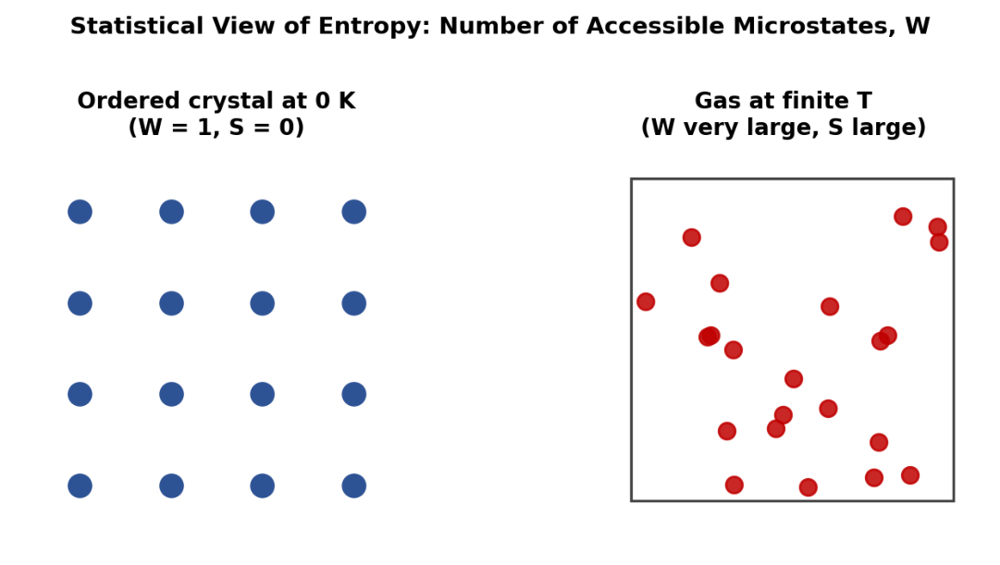{: .fig}

_Fig. 9.1 — The statistical view of entropy: an ordered crystal has only one accessible microstate (W = 1), while a gas has an enormous number (W very large), giving it much higher entropy._

### 9.3 Entropy Change for an Ideal Gas

Combining the First Law (dE = dq − PdV, so dqrev = dE + PdV) with dS = dqrev/T, and using dE = nCv dT and P = nRT/V for n moles of an ideal gas:

$$
dS = nC_v\frac{dT}{T} + nR\frac{dV}{V}
$$

Integrating between the initial and final states gives the entropy change in terms of T and V:

$$
\Delta S = nC_v \ln\frac{T_2}{T_1} + nR \ln\frac{V_2}{V_1}
$$

Using PV = nRT to eliminate V in favour of P gives the equivalent expression in terms of T and P:

ΔS = n Cp ln(T2/T1) − n R ln(P2/P1)

Special cases follow directly:

- Isothermal process (T1 = T2): ΔS = nR ln(V2/V1) = nR ln(P1/P2)

- Isochoric process (V1 = V2): ΔS = nCv ln(T2/T1)

- Isobaric process (P1 = P2): ΔS = nCp ln(T2/T1)

#### Worked Example 9.1 — Isothermal expansion
{: .example}

2 mol of an ideal gas expand isothermally and reversibly from 5 L to 50 L at 303 K. ΔS = 2.303 nR log(V2/V1) = 2.303 × 2 × 8.314 × log(10) = 38.29 J K⁻¹

#### Worked Example 9.2 — Isothermal expansion using pressures
{: .example}

2 mol of an ideal gas expand isothermally at 293 K from 10 atm to 2 atm. ΔS = 2.303 nR log(P1/P2) = 2.303 × 2 × 8.314 × log(5) = 26.76 J K⁻¹

#### Worked Example 9.3 — Heating at constant volume
{: .example}

3 mol of an ideal gas heated from 323 K to 423 K at constant volume (Cv = 32.94 J K ⁻ ¹ mol ⁻ ¹). ΔS = nCv ln(T2/T1) = 3 × 32.94 × ln(423/323) = 3 × 32.94 × 0.2696 = 26.66 J K⁻¹

### 9.4 Entropy Change on Mixing of Ideal Gases

When two or more ideal gases at the same temperature and total pressure are allowed to mix, each component gas effectively undergoes an isothermal expansion from its own initial (partial) volume to the total volume of the mixture. For a mixture in which component i has mole fraction xi, the molar entropy of mixing is always positive (since mixing always increases disorder):

ΔSmix = − R Σ xi ln xi     (per mole of mixture, or −nR Σ xi ln xi in total)

#### Worked Example 9.4 — Entropy of mixing
{: .example}

1 mol N2 and 3 mol O2 are mixed at constant T and P (mole fractions xN2 = 0.25, xO2 = 0.75). ΔSmix = −R[0.25 ln0.25 + 0.75 ln0.75] × 4 mol total = −4 × 8.314 × [0.25(−1.386)+0.75(−0.288)] = −4 × 8.314 × [−0.3466 − 0.2158] = −4 × 8.314 × (−0.5624) = +18.71 J K⁻¹ (increase, as expected)

### 9.5 Entropy Change Accompanying Phase Transition

A phase change (fusion, vaporisation, sublimation, or transition between allotropes) occurring reversibly at its transition temperature gives:

ΔSfusion = ΔHfusion/Tf     ΔSvap = ΔHvap/Tb     ΔStransition = ΔHtransition/Ttransition

#### Worked Example 9.5 — Entropy of vaporisation
{: .example}

Entropy of vaporisation of 1 mol water at 100 °C (373 K); ΔHvap = 9650 cal mol ⁻ ¹. ΔS = 9650/373 = 25.87 cal K⁻¹ mol⁻¹

#### Worked Example 9.6 — Entropy of fusion
{: .example}

Entropy increase when 1 mole of ice melts at 0 °C (273 K); latent heat of fusion = 80 cal g⁻¹ (molar mass 18 g mol ⁻ ¹).

ΔHfusion (molar) = 80 × 18 = 1440 cal mol ⁻ ¹ ΔS = 1440/273 = 5.27 cal K⁻¹ mol⁻¹

### 9.6 Entropy Change on Heating (No Phase Change)

Heating a substance at constant pressure from T1 to T2, with no phase change, gives:

ΔS = n Cp ln(T2/T1) = 2.303 n Cp log(T2/T1)

When a process involves both heating and a phase change (e.g. converting ice at 0 °C to steam at 100 °C), the overall entropy change is obtained simply by adding the entropy changes of each successive step: heating the solid to its melting point, fusion, heating the liquid to its boiling point, and vaporisation — since entropy, being a state function, is additive along any path connecting the initial and final states.

#### Worked Example 9.7 — Multi-step entropy calculation
{: .example}

Total entropy change converting 5 g of ice at 0 °C to steam at 100 °C.

Data: latent heat of fusion = 80 cal/g; latent heat of vaporisation = 540 cal/g; Cp(water) = 18 cal mol⁻¹ K⁻¹ ≈ 1 cal g ⁻ ¹ K ⁻ ¹ (M=18); moles = 5/18.

Step 1 (fusion at 273 K): ΔS1 = (5×80)/273 = 1.465 cal K ⁻ ¹

Step 2 (heating water 273→373 K): ΔS2 = (5/18)(18) ln(373/273) = 5 × 0.3122 = 1.561 cal K ⁻ ¹

Step 3 (vaporisation at 373 K): ΔS3 = (5×540)/373 = 7.239 cal K ⁻ ¹

Total ΔS = 1.465 + 1.561 + 7.239 ≈ 10.27 cal K⁻¹ (matches the standard textbook result of 10.265 cal K⁻¹)

## 10. The Carnot Heat Engine and Thermodynamic Efficiency

A heat engine converts heat, drawn from a high-temperature source, partly into work, rejecting the unused portion of the heat to a low-temperature sink. In 1824 Sadi Carnot proposed an idealised, perfectly reversible heat engine to establish the theoretical upper limit on the efficiency of any heat engine operating between two fixed temperatures.

### 10.1 The Four Steps of the Carnot Cycle

The working substance (taken as one mole of an ideal gas) is carried through four reversible steps and returned to its initial state:

1. Isothermal reversible expansion at the higher temperature T2 (volume V1 → V2), absorbing heat q2 from the source.

2. Adiabatic reversible expansion (V2 → V3), during which the temperature falls from T2 to T1.

3. Isothermal reversible compression at the lower temperature T1 (volume V3 → V4), rejecting heat q1 to the sink.

4. Adiabatic reversible compression (V4 → V1), during which the temperature rises from T1 back to T2, restoring the initial state.

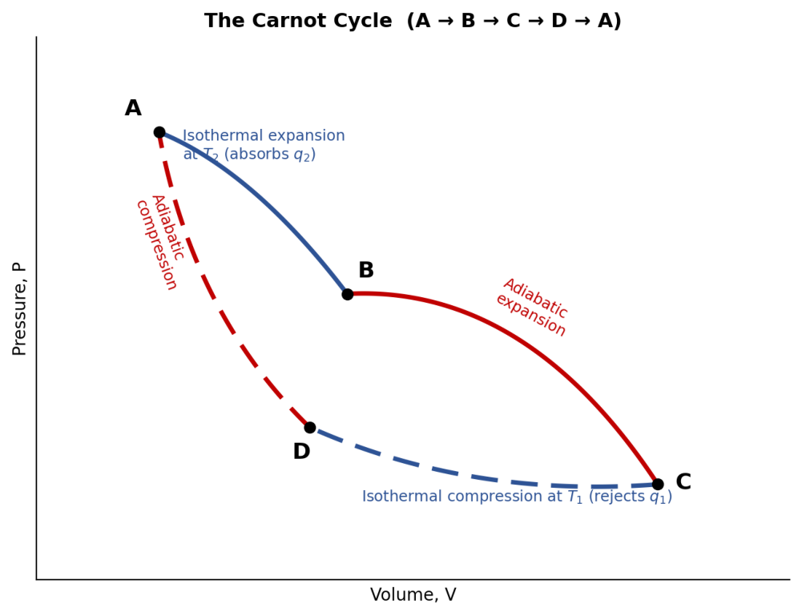{: .fig}

_Fig. 10.1 — The Carnot cycle on a P–V diagram: two isotherms (solid) connected by two adiabats (dashed), forming a closed loop whose enclosed area equals the net work done per cycle._

### 10.2 Net Work and Net Heat of the Cycle

Summing the work done in the four steps (two isothermal, two adiabatic — the adiabatic work terms cancel exactly because Cv(T2−T1) appears with opposite signs in steps 2 and 4) gives the net work of the cycle:

w(net) = RT2 ln(V2/V1) + RT1 ln(V4/V3)

Using the adiabatic relations for steps 2 and 4, it can be shown that V2/V1 = V3/V4, which allows the net heat absorbed to be simplified to:

q(net) = q2 − q1 = R(T2 − T1) ln(V2/V1) = w(net)

### 10.3 Thermodynamic Efficiency

The efficiency, η, is defined as the fraction of the heat absorbed from the source that is converted into net work:

η = w/q2 = (T2 − T1)/T2 = 1 − T1/T2

This remarkably simple result depends only on the two operating temperatures, not on the nature of the working substance — a statement known as Carnot's theorem: every reversible engine operating between the same two temperature limits has the same efficiency, regardless of the working substance. Efficiency increases as the temperature difference (T2 − T1) increases, and can only reach 100% (η = 1) if T1 = 0 K, which is unattainable.

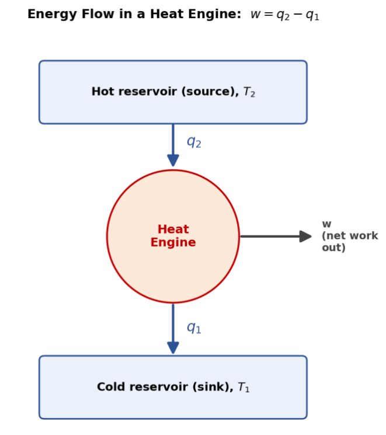{: .fig}

_Fig. 10.2 — Energy flow in a heat engine: heat q2 is drawn from the hot reservoir, part is converted to net work w, and the remainder q1 is rejected to the cold reservoir._

#### Worked Example 10.1 — Basic efficiency and work
{: .example}

A Carnot engine works between 227 °C (500 K) and 27 °C (300 K), absorbing 1000 cal per cycle. η = (500−300)/500 = 0.40;  w = ηq2 = 400 cal;  q1 = q2 − w = 600 cal rejected to the sink.

#### Worked Example 10.2 — Effect of raising source temperature
{: .example}

Compare efficiencies of a steam engine operating between the boiling point of water at 1 atm (373 K) and at 50 atm (538 K), sink at 308 K (35 °C) in each case. At 1 atm: η = (373−308)/373 = 0.174 (17.4%)

At 50 atm: η = (538−308)/538 = 0.428 (42.8%) — a striking increase in efficiency.

#### Worked Example 10.3 — Engine specification problem
{: .example}

An engine operating between 150 °C (423 K) and 25 °C (298 K) takes 500 J of heat from the source. η = (423−298)/423 = 0.2955; w = ηq2 = 0.2955 × 500 ≈ 147.75 J

## 11. Second Law of Thermodynamics

### 11.1 Statement

The Second Law of Thermodynamics may be expressed in several equivalent forms:

- Entropy statement: whenever a spontaneous process occurs, it is accompanied by an increase in the total entropy of the universe (system + surroundings). For a reversible process, ΔSuniverse = 0; for a spontaneous (irreversible) process, ΔSuniverse = ΔSsystem + ΔSsurroundings > 0.

- Kelvin statement: it is impossible, by a cyclic process, to take heat from a hot reservoir and convert it completely into work without transferring some heat to a cooler reservoir.

- Clausius statement: it is impossible for a cyclic process to transfer heat from a colder to a hotter body without external work being done.

### 11.2 Derivation of Entropy from the Carnot Cycle

For a Carnot cycle, q2/T2 = q1/T1 (from Section 10.3), which can be rearranged, using the sign convention that q2 (absorbed) is positive and q1 (rejected) is negative, to give:

q2/T2 + q1/T1 = 0,     i.e.   Σ(q/T) = 0 around the cycle

Any arbitrary reversible cycle can be approximated as closely as desired by a very large number of infinitesimally small Carnot cycles tiled across the corresponding P–V diagram. Summing Σ(q/T) = 0 over all these elementary cycles and letting their number tend to infinity gives, for any reversible cyclic process:

∮ **_dqrev / T = 0_**

A cyclic integral that vanishes identically shows that dqrev/T is an exact differential of some state function — this function is entropy, dS = dqrev/T, confirming that entropy depends only on the state of the system, not on the path taken to reach it.

For an irreversible cycle, the corresponding cyclic integral is always negative, ∮ dq/T < 0, which on analysis shows that the entropy of the final state of a spontaneous (irreversible) change always exceeds that of the initial state — in agreement with the entropy statement of the Second Law, ΔSuniverse > 0.

### 11.3 Entropy Change in an Irreversible Process

Because an irreversible Carnot cycle always has lower efficiency than a reversible one operating between the same two temperatures, q2/T2 − q1/T1 < 0 for such a cycle, i.e. the entropy of the final state is always greater than the entropy of the initial state for any spontaneous, irreversible change. Since almost all naturally occurring processes are irreversible, it is often said that the entropy of the universe is continually increasing, tending towards a maximum.

#### Worked Example 11.1 — Total entropy change (system + surroundings)
{: .example}

1 mol of an ideal gas expands isothermally and irreversibly (into a vacuum, so w = 0, q = 0) at 300 K, volume doubling.

ΔSsystem = nR ln(V2/V1) = 8.314 ln2 = 5.76 J K⁻¹ (calculated via the reversible-path formula, since S is a state function)

Since q = 0 for this free expansion, ΔSsurroundings = 0, so ΔSuniverse = +5.76 J K⁻¹ > 0, confirming the process is spontaneous (irreversible).

## 12. Third Law of Thermodynamics

### 12.1 Statement

The entropy of a substance decreases as temperature falls. As a liquid is cooled to its freezing point and then further cooled as a solid, molecular motion progressively decreases and the system becomes progressively more ordered. The Third Law of Thermodynamics states:

At absolute zero (T = 0 K), the entropy of a perfectly ordered pure crystalline substance is zero:   S = 0

At 0 K, all molecular vibration in an ideal crystal ceases and the substance exists in a single, uniquely defined microstate (W = 1), so from the statistical definition S = k ln W = k ln1 = 0.

### 12.2 Significance and Use — Absolute (Standard) Entropies

Because internal energy and enthalpy have no natural zero (only ΔE and ΔH can be measured), the Third Law is uniquely valuable in fixing an absolute reference point for entropy. Using the relation dS = Cp dT/T at constant pressure, the entropy of a substance at any temperature T can be obtained by integrating measured heat-capacity data from 0 K up to T (including terms for any phase changes along the way):

S°(T) = ∫₀ᵀ (Cp/T) dT + Σ(ΔHtransition/Ttransition)

Entropies calculated in this way from calorimetric data are called absolute or third-law entropies. The standard entropy, S°, of a substance is its absolute entropy at 298 K and 1 atm pressure; standard entropies of all substances above 0 K are always positive, since S = 0 only strictly at T = 0 K.

A representative selection of standard entropies (298 K, 1 atm) is given below.

|**Substance**|**S° / J K⁻¹ mol⁻¹**|
|---|---|
|H2(g)|130.6|
|O2(g)|205.0|
|N2(g)|191.5|
|H2O(l)|69.96|
|H2O(g)|188.7|
|CO2(g)|213.6|
|C(s,graphite)|5.7|
|NaCl(s)|72.88|

#### Worked Example 12.1 — Standard entropy change of reaction
{: .example}

For CO(NH 2 ) 2 (aq) + H 2 O(l) → CO 2 (g) + 2NH 3 (g); S°(cal mol⁻¹K⁻¹): urea 41.55, H 2 O(l) 16.72, CO 2 (g) 51.06, NH 3 (g) 46.01.

ΔS° = [51.06 + 2(46.01)] − [41.55 + 16.72] = 143.08 − 58.27 = 84.81 cal K⁻¹

### 12.3 Residual Entropy

For a small number of substances, the entropy measured calorimetrically at 0 K is not exactly zero, even though the Third Law predicts zero for a perfect crystal. This small, non-zero value is called the residual entropy, and it arises because such molecules cannot settle into a single, uniquely ordered orientation in the crystal lattice even as the temperature approaches absolute zero.

The classic example is solid carbon monoxide, CO. Because the CO molecule has a very small dipole moment, the two possible orientations (C–O and O–C) within the crystal lattice are almost equally likely, and as the crystal is cooled, molecules become 'frozen' at random into one orientation or the other rather than adopting a single ordered arrangement. This residual disorder gives CO(s) a small positive entropy at 0 K, instead of the ideal value of zero. A similar effect is observed in ice (H2O), where a degree of residual disorder persists in the arrangement of hydrogen bonds even in the solid at very low temperature.

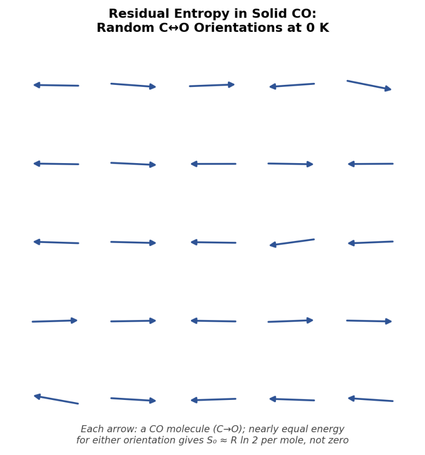{: .fig}

_Fig. 12.1 — Residual entropy in solid CO: because the C and O ends are nearly identical in size and the dipole is very weak, molecules freeze into random C↔O orientations, leaving nonzero entropy at 0 K._

_Residual entropy is a useful diagnostic: whenever the calorimetric (third-law) entropy of a substance disagrees with the entropy calculated independently by statistical mechanics (using spectroscopic data), the difference is generally attributed to residual entropy arising from incomplete ordering in the crystal at 0 K._

## Additional Solved Numerical Problems

The following fully worked problems draw together several concepts from this unit and are recommended for consolidation before attempting the Review Questions.

#### Solved Problem 1 — Combined First Law and heat capacity
{: .example}

5 mol of an ideal gas (Cv = 20.8 J K⁻¹ mol⁻¹) is heated from 300 K to 400 K at constant volume, and then allowed to expand isothermally and reversibly at 400 K to twice its volume.

Step 1 (heating, constant V): ΔE1 = nCvΔT = 5 × 20.8 × 100 = 10 400 J; w1 = 0; q1 = ΔE1 = 10 400 J. Step 2 (isothermal expansion): ΔE2 = 0; w2 = nRT ln2 = 5 × 8.314 × 400 × 0.693 = 11 526 J (done by gas); q2 = w2 = 11 526 J.

Overall: ΔE(total) = 10 400 J; q(total) = 21 926 J; w(total) = 11 526 J — illustrating that ΔE depends only on the net temperature change, while q and w depend on the path taken.

#### Solved Problem 2 — Enthalpy of formation via Hess's Law and bond-energy cross-check
{: .example}

Estimate ΔHf(CH4) two ways: (a) using combustion data, (b) using bond energies, and compare. (a) Combustion data: ΔHc(C,s)=−393.5, ΔHc(H 2 ,g)=−285.8 (×2=−571.6), ΔHc(CH 4 ,g)=−890.3 kJ mol ⁻ ¹. C(s)+2H 2 (g)→CH 4 (g): ΔHf = [−393.5 + (−571.6)] − (−890.3) = −965.1+890.3 = −74.8 kJ mol ⁻ ¹

(b) Bond-energy route requires the enthalpy of sublimation of carbon and the dissociation energy of H 2 (spectroscopic data) combined with 4×E(C–H); this independent route gives a closely similar value (~−75 kJ mol⁻¹), illustrating that Hess's Law (macroscopic) and bond-energy summation (molecular) are consistent, complementary methods.

#### Solved Problem 3 — Entropy and spontaneity check
{: .example}

For the reaction A(g) → 2B(g) at 298 K, ΔH = +30 kJ mol⁻¹ and ΔS = +100 J K⁻¹ mol⁻¹. Is the process expected to be spontaneous at 298 K? At what temperature does it become spontaneous?

Since both ΔH and ΔS are positive, the process becomes more favourable as T increases (this anticipates the Gibbs energy criterion, ΔG = ΔH − TΔS, developed fully in Unit III).

Setting ΔH = TΔS: T = ΔH/ΔS = 30 000/100 = 300 K. Below 300 K the process is non-spontaneous; above 300 K it becomes spontaneous — at 298 K it is (marginally) non-spontaneous.

#### Solved Problem 4 — Carnot cycle with entropy check
{: .example}

A Carnot engine absorbs 2000 cal from a source at 400 K and rejects heat to a sink at 250 K. Calculate (a) efficiency, (b) work done, (c) heat rejected, (d) entropy change of the source and of the sink.

(a) η = (400−250)/400 = 0.375   (b) w = ηq2 = 0.375×2000 = 750 cal

(c) q1 = q2 − w = 2000 − 750 = 1250 cal

(d) ΔSsource = −q2/T2 = −2000/400 = −5.0 cal K ⁻ ¹ (entropy decreases as heat leaves the source)

ΔSsink = +q1/T1 = 1250/250 = +5.0 cal K ⁻ ¹ (entropy increases as heat enters the sink)

Net ΔS(universe) = −5.0+5.0 = 0, confirming the cycle is perfectly reversible, as expected for an ideal Carnot engine.

## Summary of Key Equations — Unit II

|**Topic**|**Key equation(s)**|
|---|---|
|First Law|ΔE =q− w|
|Enthalpy|H = E + PV;ΔH =qP|
|Heat capacities|Cp− Cv = R;ΔE = nCvΔT;ΔH = nCpΔT|
|Isothermal reversible work|w = −2.303 nRT log(V2/V1)|
|Adiabatic reversible relations|TVᵞ⁻¹ = const.;PVᵞ = const.|
|Adiabatic reversible work|w = nCv(T1 − T2)|
|ΔH vs ΔE|ΔH = ΔE + ΔnRT|
|Kirchhoff's equation|ΔH2 − ΔH1 = ΔCp(T2 − T1)|
|Entropy (thermodynamic)|dS = dqrev/T|
|Entropy (statistical)|S = k ln W|
|Entropy, idealgas|ΔS = nCv ln(T2/T1)+ nR ln(V2/V1)|
|Entropyof mixing|ΔSmix = −nR Σ xi ln xi|
|Phase-change entropy|ΔS = ΔHtransition / Ttransition|
|Carnot efficiency|η=(T2 − T1)/T2|
|Third Law|S = 0 at T = 0 K(perfect crystal)|

## Review Questions

#### A. Short-Answer Questions (Remember / Understand)

1. Define a thermodynamic system. Distinguish between open, closed and isolated systems with one example each.

2. Differentiate between intensive and extensive properties, giving two examples of each.

3. Distinguish between state functions and path functions.

4. State the First Law of Thermodynamics in any two equivalent forms.

5. Define enthalpy. Why is ΔH equal to qP?

6. Why is Cp always greater than Cv for a gas?

7. State Hess's Law of constant heat summation.

8. Define bond energy and bond dissociation enthalpy. How do they differ?

9. What is meant by a spontaneous process? Give two examples.

10. State the thermodynamic and statistical definitions of entropy.

11. State the Second Law of Thermodynamics in the Kelvin and Clausius forms.

12. State the Third Law of Thermodynamics. What is meant by residual entropy?

#### B. Long-Answer / Derivation Questions (Apply / Analyze)

13. Derive the expression for the work done in the reversible isothermal expansion of an ideal gas from V1 to V2.

14. Derive the relation Cp − Cv = R for one mole of an ideal gas.

15. Derive the relations TVᵞ⁻¹ = constant and PVᵞ = constant for a reversible adiabatic process.

16. Derive Kirchhoff's equation and explain its use in calculating the enthalpy of reaction at a different temperature.

17. Describe the four steps of the Carnot cycle and derive the expression for its thermodynamic efficiency.

18. Show that entropy is a state function using the Carnot cycle.

19. Derive the expression for the entropy change of an ideal gas in terms of T and V.

20. Explain, with justification, why the melting of ice is spontaneous even though it is endothermic.

#### C. Numerical Problems (Apply / Analyze / Evaluate)

21. Calculate the work done when 2 mol of an ideal gas expand isothermally and reversibly at 300 K from 5 L to 25 L.

22. 3 mol of an ideal gas (Cv = 3R/2) are heated from 250 K to 400 K at constant volume. Calculate ΔE and ΔH.

23. One mole of an ideal gas at 25 °C expands adiabatically and reversibly from 10 atm to 2 atm (γ = 1.4). Calculate the final temperature and the work done.

24. Using Hess's Law, calculate the enthalpy of formation of methane given the enthalpies of combustion of carbon, hydrogen and methane.

25. The enthalpy of a reaction is −40.0 kJ at 300 K; ΔCp = −20 J K⁻¹. Calculate the enthalpy of the reaction at 350 K using Kirchhoff's equation.

26. Calculate the entropy change when 5 mol of an ideal gas expand isothermally and reversibly from 10 L to 100 L.

27. Calculate the entropy of vaporisation of ethanol at its boiling point of 78.4 °C, given ΔHvap = 42.3 kJ mol⁻¹.

28. A Carnot engine operates between 227 °C and 27 °C, absorbing 2000 J from the source. Calculate the efficiency, the work done and the heat rejected.

29. Calculate the entropy of mixing when 2 mol of N2 and 2 mol of O2 are mixed at constant temperature and pressure.

30. Estimate the enthalpy of the reaction N2(g) + 3H2(g) → 2NH3(g) using the bond energies of N≡N, H–H and N–H bonds (945, 436 and 391 kJ mol⁻¹ respectively).

#### D. Higher-Order Thinking (HOTS) Questions (Evaluate / Create)

_The following questions require the integration of more than one concept from this unit and are of JAM/competitive-examination difficulty._

31. A reaction has ΔH < 0 and ΔS < 0. Using entropy and enthalpy considerations, discuss under what temperature conditions (if any) such a reaction could be spontaneous — and connect your reasoning to the concept of free energy that will be developed in Unit III.

32. Two Carnot engines are connected in series, the heat rejected by the first being used as the input to the second, operating overall between T1 and T3 (T1 > T2 > T3). Show that the combined efficiency of the two engines in series equals the efficiency of a single Carnot engine operating directly between T1 and T3.

33. Explain, using the statistical definition of entropy, why the entropy of mixing of two distinguishable ideal gases is always positive, whereas 'mixing' two samples of the same gas produces (in principle) no increase in entropy. Discuss briefly why this apparent discontinuity troubled early statistical mechanics (the Gibbs paradox).

34. Justify, from first principles, why no real engine operating between two fixed temperature reservoirs can ever exceed the Carnot efficiency, even in principle, and explain what this implies for the ultimate efficiency limits of thermal power stations.

35. A solid shows a measured (calorimetric) entropy at 0 K that is greater than zero. Propose, with reasoning, what this observation implies about the molecular arrangement in the crystal, and suggest one experimental method (independent of calorimetry) that could be used to estimate this residual entropy.

## Quick Revision Checklist

Use this checklist for last-minute revision before a test on this unit. Tick off each item once you can state it, derive it, or solve a numerical based on it without referring to notes.

- Classification of systems (isolated / closed / open) and one example of each.

- Intensive vs extensive properties — at least three examples of each.

- Sign convention for q and w used consistently throughout a numerical problem.

- Derivation of w = −2.303 nRT log(V2/V1) for reversible isothermal expansion.

- Derivation of Cp − Cv = R.

- Derivation of TVᵞ⁻¹ = constant for reversible adiabatic processes.

- ΔH = ΔE + ΔnRT and when Δn = 0.

- Hess's Law — combining thermochemical equations algebraically.

- Kirchhoff's equation and its use in shifting ΔH from one temperature to another.

- Estimating ΔH of a gas-phase reaction from bond energies.

- Statistical (S = k ln W) and thermodynamic (dS = dqrev/T) definitions of entropy, and how they connect.

- Entropy change formulae for isothermal, isochoric and isobaric processes.

- Entropy of mixing, and entropy change accompanying a phase transition.

- The four steps of the Carnot cycle and the derivation η = (T2−T1)/T2.

- Kelvin and Clausius statements of the Second Law, and how ∮dqrev/T = 0 shows entropy is a state function.

- The Third Law statement and the meaning of residual entropy, with the CO(s) example.

---

[← Course home](./) · [Back to top](#)

